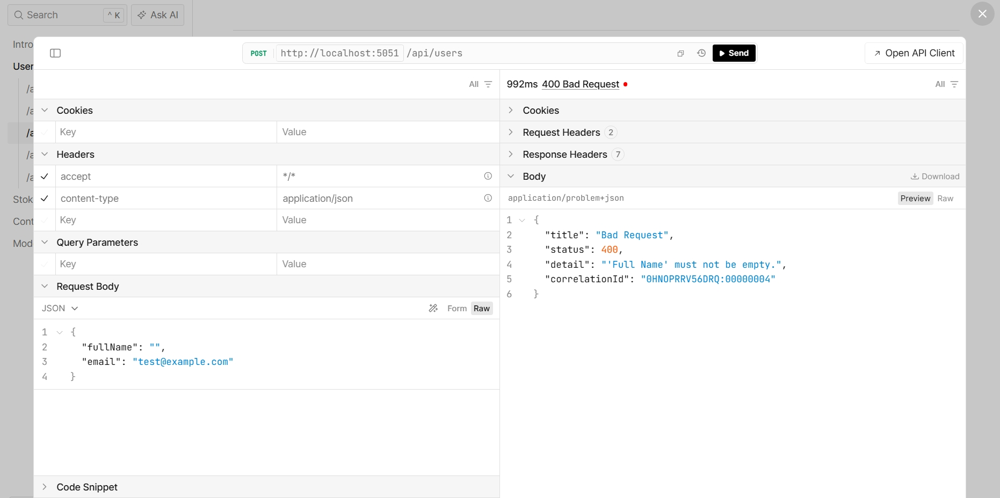
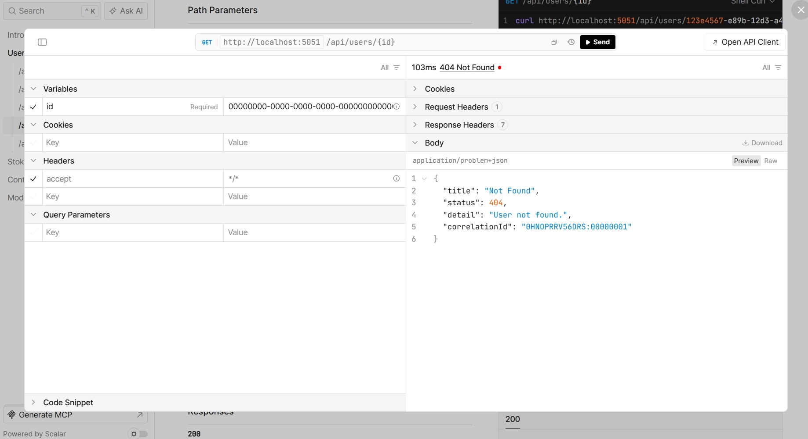
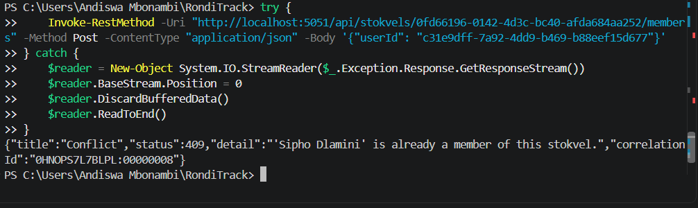
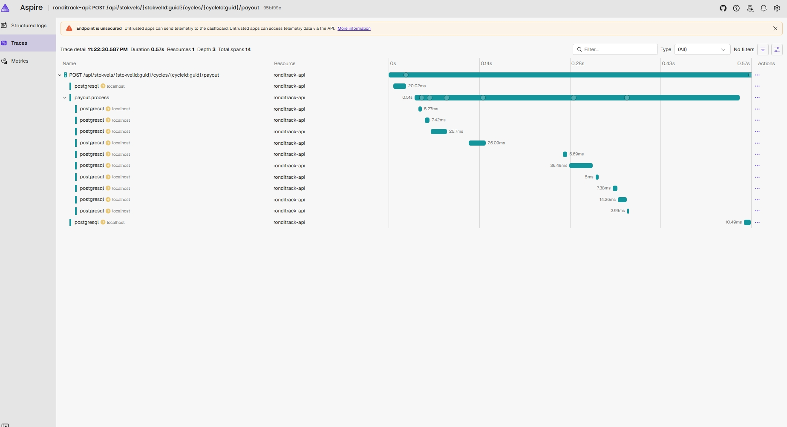
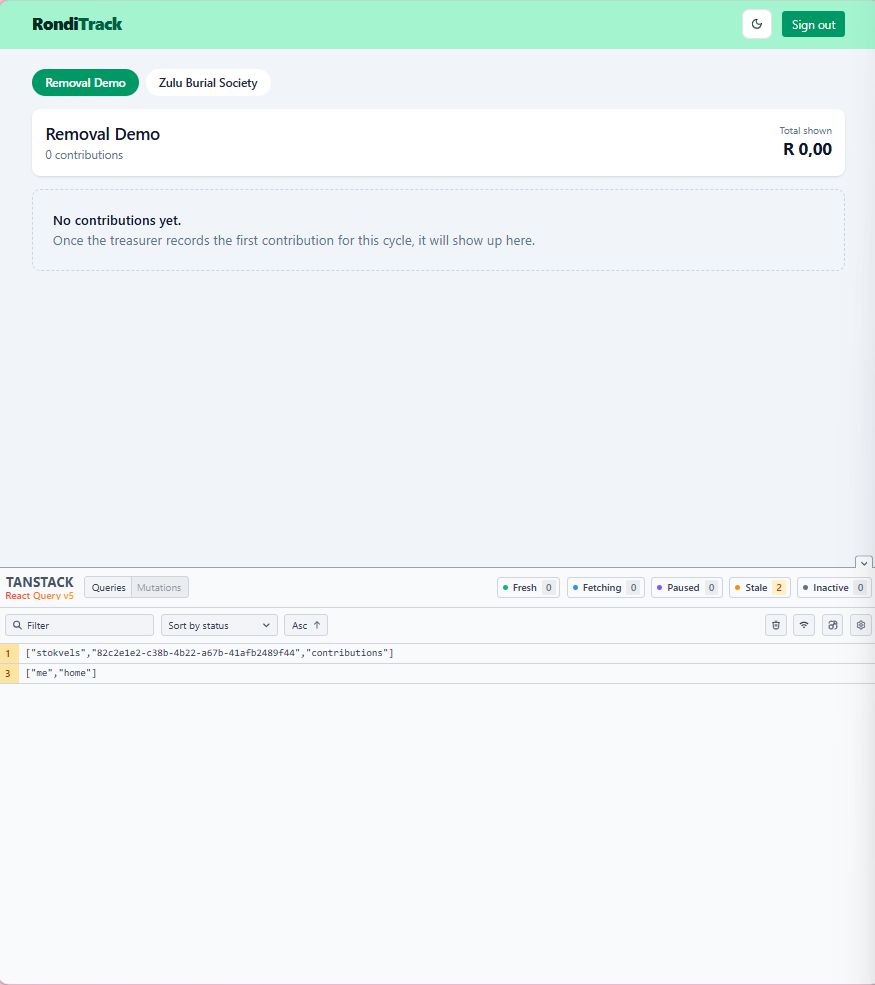

# RondiTrack

[](https://github.com/AndiswaMbonambi08/RondiTrack/actions/workflows/ci.yml)

RondiTrack is a stokvel (rotating savings group) tracker. Members pay contributions into a cycle, treasurers confirm them, close the cycle and record payouts. The API models the real rules of a stokvel in code so invalid states can't happen, and it treats money, retries and personal information carefully.

## What it does

- Users, stokvels, memberships with a **role per stokvel** (a person can be a Member of one stokvel and the Treasurer of another).
- Contribution cycles, contribution recording and payouts.
- Invite codes: preview a stokvel's rules, then join in three steps.
- Proof of payment upload and download, visible only to the uploader and that stokvel's treasurers.
- A close preview calculated by the API, then a safe cycle close.
- A scheduled job that closes cycles and records arrears exactly once.
- A home-screen endpoint (`/api/v1/me/home`) that returns everything a member's home screen needs in one response.

## Tech stack

| Area | Technology |
|---|---|
| API | ASP.NET Core 10, C#, FluentValidation, RFC 9457 Problem Details |
| Data | PostgreSQL 17, Entity Framework Core 10 (code-first migrations) |
| Auth | JWT access tokens, rotating refresh tokens in an HttpOnly cookie |
| Observability | OpenTelemetry (traces, metrics, logs), health probes |
| Web | React + TypeScript (Vite, Tailwind CSS, shadcn/ui) in `web/`; Next.js 16 in `web-next/` |
| Contract | OpenAPI document, generated TypeScript types in `clients/typescript/` |
| Tests | xUnit, WebApplicationFactory, Testcontainers; Vitest, React Testing Library, Mock Service Worker |
| Delivery | Docker (multi-stage, non-root), Docker Compose, GitHub Actions |

## Repository layout

| Folder | Contents |
|---|---|
| `Domain/` | Entities and business rules. References no other project |
| `Infrastructure/` | `DbContext`, EF repositories, migrations |
| `Endpoints/`, `Authorization/`, `Browser/`, `ErrorHandling/`, `Services/`, `Mapping/`, `Jobs/` | The API: routes, authorization handlers, CORS and rate limiting, the central exception handler, services, hand-written mapping, background jobs |
| `RondiTrack.Tests/` | Unit and integration tests |
| `clients/typescript/` | Generated API types and a strict-mode compile check |
| `web/` | React front end |
| `web-next/` | Next.js 16 front end (server-side session, backend-for-frontend) |
| `docs/proofs/` | Captured evidence (contract checks, test output) |

Dependencies point inward: API → Infrastructure → Domain. Domain has no package references.

## Run it (only Docker needed)

```
git clone https://github.com/AndiswaMbonambi08/RondiTrack.git
cd RondiTrack
copy .env.example .env
```

Fill in `.env`: `POSTGRES_DB`, `POSTGRES_USER`, `POSTGRES_PASSWORD`, `JWT_SIGNING_KEY` (at least 32 characters) and `SEED_DEMO_PASSWORD` (at least 12 characters). Compose refuses to start if one is missing. Then:

```
docker compose up --build
```

Use the port shown by `docker compose ps` (normally 8080):

| What | URL |
|---|---|
| Scalar API reference | http://localhost:8080/scalar/v1 |
| OpenAPI document | http://localhost:8080/openapi/v1.json |
| Liveness | http://localhost:8080/health/live |
| Readiness (checks PostgreSQL) | http://localhost:8080/health/ready |

### Demo accounts

Made-up data. Every account's password is the `SEED_DEMO_PASSWORD` you chose.

| Email | Role |
|---|---|
| thandiwe@example.com | Admin of Ubuntu Savings Circle |
| sipho@example.com | Member of Ubuntu Savings Circle and Treasurer of Umoja Family Fund (a member in two stokvels) |
| nomsa@example.com | Admin of Umoja Family Fund |
| lindiwe@example.com | Inactive account, cannot sign in |
| admin@example.com | Platform admin (can see every stokvel) |

### Running the front ends

```
cd web          # or web-next
npm install
npm run generate:api   # needs the API running
npm run dev
```

## Authentication

1. `POST /api/v1/auth/login` returns a 15-minute access token in the body and sets the `refresh_token` cookie.
2. Send `Authorization: Bearer <access token>` on every call. Keep the access token in memory only.
3. When it expires, or on page reload, call `POST /api/v1/auth/refresh` with `credentials: "include"`. You get a new access token and a new cookie.
4. Replaying a refresh token that was already used revokes the whole session family and returns 401. The user signs in again.
5. `POST /api/v1/auth/logout` revokes the family and always returns 204.

| Token | Details |
|---|---|
| Access token | Signed JWT (HS256), 15 minutes, 30 s clock skew. Claims: `sub`, `jti`, `iss`, `aud`, `iat`, `nbf`, `exp`, plus a role claim for platform admins only |
| Refresh token | 32 random bytes, not a JWT, stored only as a SHA-256 hash, 7 days |
| Cookie | `HttpOnly; Secure; SameSite=Strict; Path=/api/v1/auth` |

Passwords are hashed with ASP.NET Core's `PasswordHasher<User>` and must be at least 12 characters. Emails are lower-cased and unique. Login returns the same 401 for an unknown email, a wrong password and an inactive account, and always verifies against a dummy hash so response time doesn't reveal which emails exist.

## Authorization

Authentication proves who someone is. Authorization decides what they may do **in one particular stokvel**, so it is checked against the database on every request and never carried in the token.

- Not a member of the stokvel → **404**, the same text as a stokvel that doesn't exist, so existence stays private.
- A member without the required role → **403**.
- Role order: Member, Treasurer, Admin. Admin passes every Treasurer check.
- The one plain role check is `GET /api/v1/stokvels`, for platform admins. Everything else uses policies and custom handlers.

| Action | Non-member | Member | Treasurer | Admin |
|---|---|---|---|---|
| View members, cycles, contributions | 404 | 200 | 200 | 200 |
| Record your own contribution | 404 | 201 | 201 | 201 |
| Record someone else's contribution | 404 | 403 | 201 | 201 |
| Process a payout | 404 | 403 | 201 | 201 |
| Update or delete the stokvel | 404 | 403 | 403 | 200 / 204 |

## Safe money handling

**Idempotency.** `POST /api/v1/stokvels/{id}/contributions` requires an `Idempotency-Key` header.

- Same key and same body: the original response is replayed with `Idempotency-Replayed: true`. Nothing new is recorded.
- Same key, different body: 422.
- A new key for a member who already paid this cycle: 409.
- A request rejected with 429 never reaches the key store, so retrying after `Retry-After` with the same key records the contribution exactly once.
- Contributions into a Closed or PaidOut cycle are refused with 409.

**Amounts** are integer cents (`int64`), so JavaScript clients add and compare exactly.

**Concurrency and consistency.** Edited entities use PostgreSQL `xmin` optimistic concurrency (stale update → 412, missing token → 428). Unique indexes enforce one contribution per member per cycle, one payout per cycle, one set of arrears per member per cycle and one cycle per start date. A payout runs inside an explicit transaction.

**Closing a cycle.** The close preview lists who goes into arrears, how much, the South African date it counts to, and a version. A stale version is refused with 409 and nothing is recorded. The same code (`ArrearsCalculator`) powers the preview and the scheduled close.

## Rate limiting and CORS

| Policy | Algorithm | Partition | Default |
|---|---|---|---|
| login | Fixed window | Client IP | 5 per 60 s |
| record-contribution | Token bucket | Signed-in user | 30, refills 1 per 10 s |
| process-payout | Token bucket | Signed-in user | 5, refills 1 per 30 s |

Every rejection is a `429` problem response with a `Retry-After` header. Money limits use a token bucket because a treasurer may record twenty contributions after a meeting and then nothing for a month.

CORS allows exact origins from `Cors:AllowedOrigins` (empty by default, `http://localhost:3000` in Development). Credentials are allowed, wildcards are rejected at startup and the request's `Origin` is never reflected. The `Idempotency-Key` header is allowed, and `Retry-After`, `ETag`, `Location` and `Idempotency-Replayed` are exposed.

## Error contract

Every error is `application/problem+json` with `status`, `title`, `detail` and a `correlationId` equal to the request's W3C trace ID. Validation failures add an `errors` map keyed by camelCase field name. A 5xx never exposes a type name, stack trace or exception message.

| Status | When |
|---|---|
| 400 | Validation failure, malformed JSON, a number sent as a string, missing header |
| 401 | Missing or invalid token, failed login or refresh |
| 403 | Authenticated but missing the role |
| 404 | Missing resource, or a stokvel the caller isn't in |
| 409 | Duplicate member or contribution, closed cycle, stale close preview |
| 412 / 428 | Stale or missing concurrency token |
| 422 | Idempotency key reused with a different body |
| 429 | Rate limit exceeded |
| 500 | Unexpected error, generic message only |

All of these come from one central exception handler, so they share one shape. Examples captured in Scalar:

**400 Bad Request** (empty full name)



**404 Not Found** (nonexistent user)



**409 Conflict** (duplicate membership, captured with PowerShell against the running API)



## Background jobs

**Cycle close.** Cycle dates are calendar dates in `Africa/Johannesburg`, compared against `TimeProvider` (never `DateTime.Now`). A cycle ending on the 25th closes at 00:00 SAST on the 26th, which is 22:00 UTC on the 25th. Each stokvel closes in its own transaction using a conditional `UPDATE ... WHERE ClosedAtUtc IS NULL`, so a cycle closes exactly once even with two replicas or a crash. Arrears are stored as whole cents. If a stokvel is several periods behind, the job closes the overdue cycle and opens only the current period. One failing stokvel never stops the others.

**Housekeeping.** Deletes expired refresh tokens (kept 30 days past expiry so reuse detection still works) and old idempotency records (kept 168 hours so late retries still replay), using set-based `ExecuteDeleteAsync`.

## Observability and POPIA

- Traces, metrics and logs via OpenTelemetry, service name `ronditrack-api`. Export only happens when `OTEL_EXPORTER_OTLP_ENDPOINT` is set, so tests and CI need no dashboard.
- A custom `payout.process` span nests the payout's SQL spans. Its tags (`payout.cycle_id`, `payout.outcome`, `error.type`) contain no names, amounts or bank details.



- Business metrics use small fixed tag sets (for example `outcome`: success or failed, `result`: not_found or forbidden). No stokvel id, user id or amount is ever a tag.
- Logs identify people only by internal ids. Typed emails, passwords, tokens and amounts are never logged, and a test fails if they appear.
- `/health/live` runs no checks. `/health/ready` checks PostgreSQL with a 2 s timeout. Both are anonymous and return only Healthy or Unhealthy.
- To view telemetry locally: run the Aspire dashboard (laptop only, unauthenticated, never deploy it), set `OTEL_EXPORTER_OTLP_ENDPOINT=http://localhost:4317` and start the API.

## Front ends

Both front ends call the same API, using types generated from its OpenAPI document. Amounts stay in cents and are formatted only for display.

**React (`web/`).** Stokvel cards show the caller's role from that stokvel's own entry, never from the token. Status badges use words, icons and tones, never colour alone. Cycles are grouped with the Open cycle expanded, and the due-date countdown counts South African calendar days and re-renders once at the next Johannesburg midnight. Tailwind and shadcn/ui with light and dark themes, checked at 360 px with every group expanded.


- The access token lives in memory only. Token refresh is single-flight, so five parallel 401s cause exactly one refresh.
- Signing out clears the query cache, the selected stokvel and the tree, so the next person on a shared phone sees none of the previous person's data.



- Recording a contribution creates one idempotency key per intent and reuses it on every retry. It is not optimistic: the button stays disabled until the API answers and the queries refetch, because "Recorded" means the money is in the books.
- A timer cleanup test shows StrictMode leaving exactly one live timer per countdown:


**Next.js 16 (`web-next/`).** The browser never calls the API. Server Components, Server Actions and `/bff/` Route Handlers call it with a token held in an encrypted HttpOnly session cookie. Silent token refresh happens only in `proxy.ts`. Features include:

- A three-step join flow with the step in the URL and nothing asked twice.
- Proof-of-payment upload (JPEG, PNG or PDF, up to 5 MB, judged by the file's bytes) and a download route that sends `nosniff` and `no-store`.
- A Close Cycle alert dialog driven by the API's preview. A stale preview gets a 409 and the dialog shows the new preview to confirm again.

## Testing

- **Back end:** 158 tests (xUnit, WebApplicationFactory, Testcontainers). Integration tests start their own throwaway PostgreSQL, so they pass with the development database stopped.
- **Front end (`web/`):** 82 tests (Vitest, React Testing Library, Mock Service Worker), including a single-flight token refresh test and a retry test proving the idempotency key is reused.
- Tests that matter were broken on purpose to confirm they fail, for example making a new idempotency key per attempt (3 of 7 tests failed) and adding `keepPreviousData` to a stokvel-keyed query.
- `clients/typescript/` compiles the generated types under `tsc --noEmit --strict`. Renaming a response field in C# turns the build red.

```
dotnet test
cd web && npx vitest run
cd clients/typescript && npm run verify
```

## Container and CI

- Multi-stage Dockerfile, non-root user, listens on port 8080. Image size about 358 MB. The image contains no secrets and fails at startup with a clear message if configuration is missing.
- `compose.yaml` runs the API and PostgreSQL 17.6. The database has a `pg_isready` health check, a named volume and no published port. The API waits for it with `service_healthy`. Every secret comes from `.env`, which is git-ignored.
- GitHub Actions builds in Release and runs all tests (including Testcontainers) on every push to `main` and every pull request. The Docker image is built only if tests pass.
- Migrations run at startup inside a PostgreSQL advisory lock, so two replicas can't migrate or seed at the same time.

## Configuration

"Secret" means never commit it and never put it in the image.

| Variable | Required | Secret | Default |
|---|---|---|---|
| `POSTGRES_DB`, `POSTGRES_USER` | yes | no | none |
| `POSTGRES_PASSWORD` | yes | yes | none |
| `JWT_SIGNING_KEY` (becomes `Jwt__SigningKey`) | yes | yes | none, at least 32 bytes |
| `SEED_DEMO_PASSWORD` (becomes `Seed__DemoPassword`) | yes in compose | yes | none |
| `ConnectionStrings__RondiTrack` | yes | yes | built by compose |
| `Cors__AllowedOrigins__0` | for a browser front end | no | empty |
| `Jwt__AccessTokenMinutes`, `Jwt__ClockSkewSeconds`, `Jwt__RefreshTokenDays` | no | no | 15, 30, 7 |
| `RateLimit__Login__PermitLimit`, `__WindowSeconds` | no | no | 5, 60 |
| `CycleClose__Enabled`, `__IntervalMinutes`, `__TimeZoneId`, `__CycleEndDay` | no | no | true, 15, Africa/Johannesburg, 25 |
| `Housekeeping__RefreshTokenRetentionDays`, `__IdempotencyRetentionHours` | no | no | 30, 168 |
| `Health__ReadyTimeoutSeconds` | no | no | 2 |
| `OTEL_EXPORTER_OTLP_ENDPOINT` | no | no | unset |

## Before production

- Set `ASPNETCORE_ENVIRONMENT=Production`, `Seed__Enabled=false` and `Docs__Enabled=false`. Compose defaults to Development with demo data.
- Run migrations in a one-shot step before the API instead of at startup.
- Put TLS in front of the API (the refresh cookie is `Secure`).
- Use a shared store for rate limits and idempotency keys, and add forwarded-headers handling. Today limits are per instance and every client behind a proxy shares one IP.
- Use a secret manager rather than a `.env` file.
- Add log retention, sampling and alerting. The Aspire dashboard has no authentication.

## Known gaps

- Roles and the platform-admin flag can only be changed in the database. There is no endpoint.
- Access tokens can't be revoked before they expire (15 minutes).
- Two browser tabs refreshing at the same instant can sign the user out, because reuse detection treats the second refresh as a replay.
- The invite-code guessing endpoint has no rate limit yet.
- Login is limited by IP only, which hurts people sharing one network.
- Users are still held in memory with a mirrored row in the database (to satisfy the foreign key). Moving users fully to EF Core is the clean fix.
- Proof-of-payment files are stored in the database (up to 5 MB each).
- The development database is shared with integration tests that don't use Testcontainers.
- The before and after `EXPLAIN ANALYZE` plans for the paging index have not been captured.
- Deleting a stokvel leaves its cycles, and deleting a user leaves their memberships.
