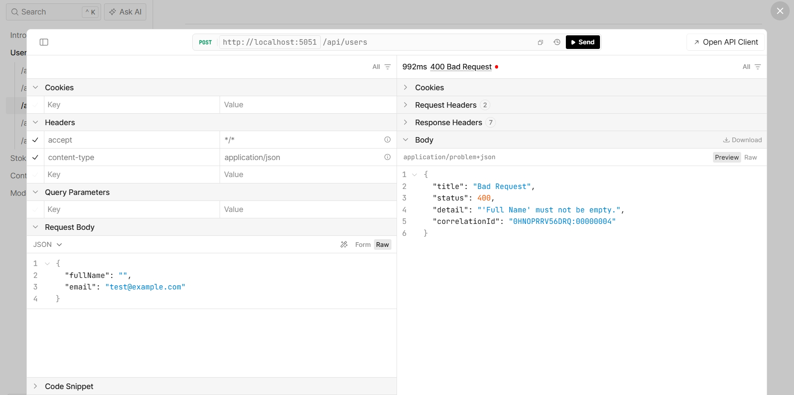
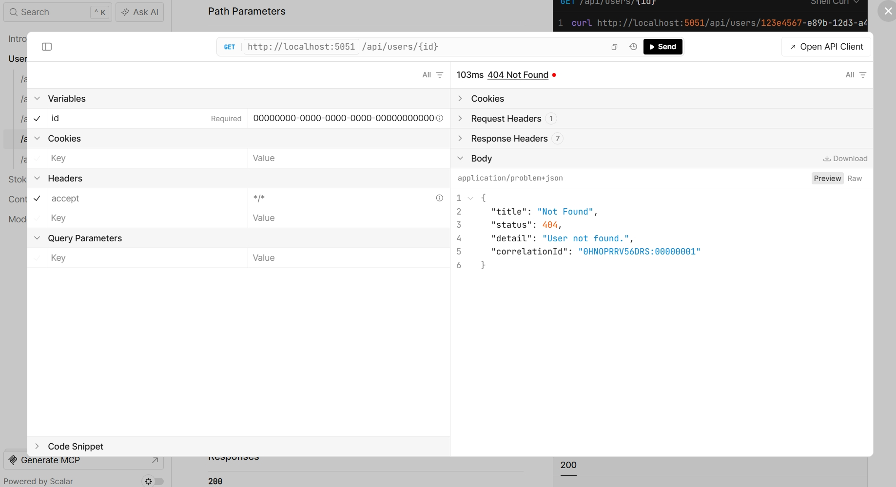
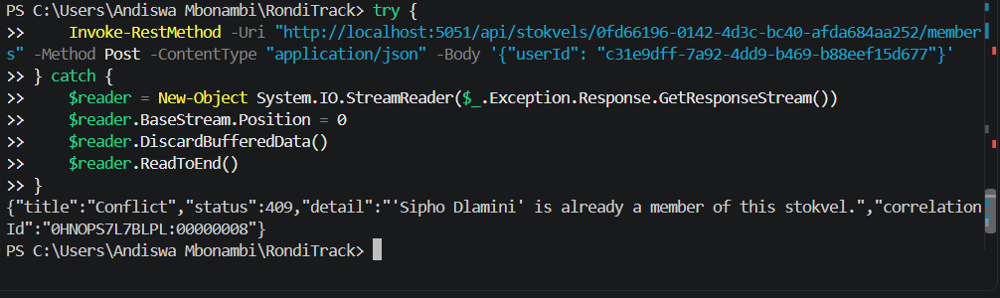
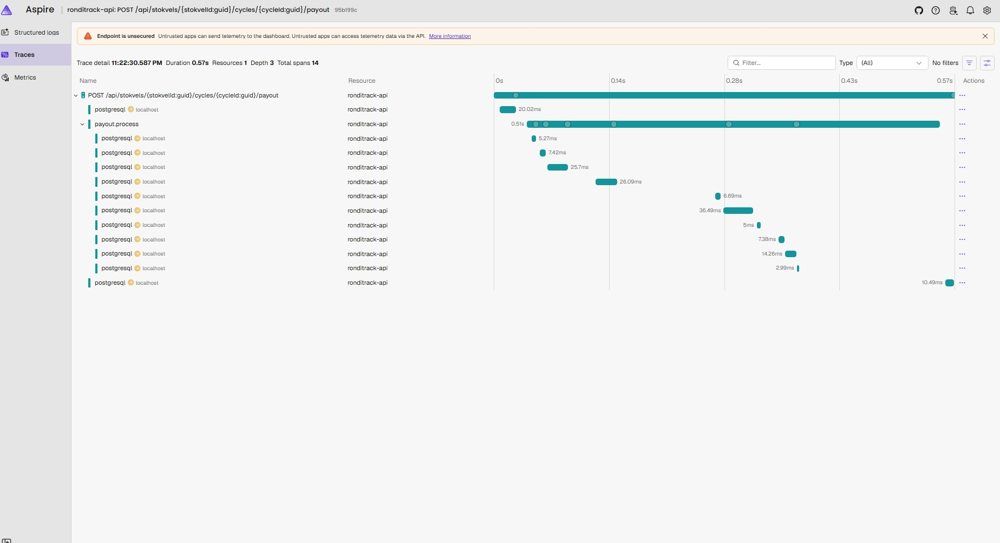
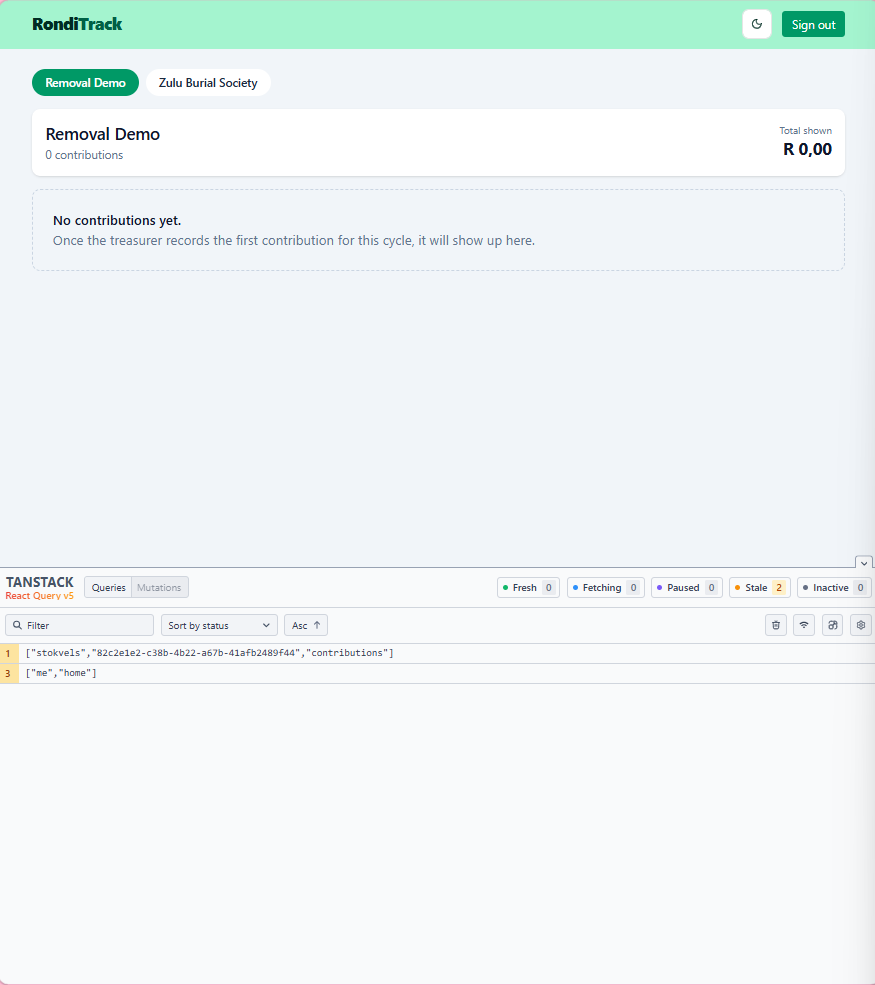

# RondiTrack
RondiTrack is the foundation of a backend API for managing stokvels, rotating savings groups widely used in South Africa. Built with ASP.NET Core 10 Minimal APIs, it models the real-world rules of stokvels directly in code, ensuring invalid states are impossible rather than just checked later. The project focuses on domain modeling, HTTP contracts, and resource-oriented routing, laying the groundwork for a production-ready API.

Minimal APIs were chosen over Controllers because they keep the project lightweight and focused. For an assignment centered on domain modeling and HTTP fundamentals, Minimal APIs reduce boilerplate, make routes explicit, and keep the logic close to the domain rules. This clarity helps demonstrate how the API enforces fairness and accountability in stokvels.

## Setup
Prerequisites

Requires the .NET 10 SDK specifically (`dotnet --list-sdks` should show a 10.x.x entry). Older SDKs will fail with error NETSDK1045.

A terminal or IDE (Visual Studio, Rider, VS Code)

## Steps
Clone the repo: git clone https://github.com/AndiswaMbonambi08/RondiTrack.git

cd RondiTrack

Run the app: dotnet run

Open the Scalar UI: http://localhost:5051/scalar/v1

## Usage
Domain Rules

Inactive users cannot join a stokvel. Prevents non-participating members from claiming payouts unfairly.

A user cannot join the same stokvel twice. Stops duplicate membership that would allow double payout claims.

A stokvel cannot be created without a name or with a contribution amount of 0 or less. Ensures clarity and financial meaning; a nameless or zero-value stokvel undermines trust.

These rules reflect how stokvels operate in reality: fairness, accountability, and trust are non-negotiable.

## Example API Calls

### Create a user
POST /api/v1/users
Content-Type: application/json

{
  "fullName": "Andiswa Mbonambi",
  "email": "andiswa@example.com"
}

### Create a stokvel
POST /api/v1/stokvels
Content-Type: application/json

{
  "name": "Holiday Savings",
  "contributionAmount": 500
}

### Join a stokvel
POST /api/v1/stokvels/{id}/members
Content-Type: application/json

{
  "userId": "<a real user id from GET /api/v1/users>"
}

### Create a contribution cycle
POST /api/v1/contribution-cycles
Content-Type: application/json

{
  "stokvelId": "<a real stokvel id>",
  "label": "2026-09",
  "targetAmount": 500
}

### Record a contribution (idempotent)
POST /api/v1/stokvels/{id}/contributions
Content-Type: application/json
Idempotency-Key: key-1

{
  "userId": "<a real member id>",
  "contributionCycleId": "<a real cycle id from POST /api/v1/contribution-cycles>",
  "amount": 500
}

Sending this exact request again with the same Idempotency-Key returns the same response with no new contribution recorded. Sending it again with the same key but a different amount or contributionCycleId returns 422 Unprocessable Entity.

## Error cases
All errors follow RFC 9457 Problem Details (application/problem+json), produced by a single centralized exception handler:

Inactive user joining:
{
  "title": "Conflict",
  "status": 409,
  "detail": "'Lindiwe Zulu' is inactive and cannot join a stokvel."
}

Duplicate membership:
{
  "title": "Conflict",
  "status": 409,
  "detail": "'Sipho Dlamini' is already a member of this stokvel."
}

Invalid stokvel creation:
{
  "title": "Bad Request",
  "status": 400,
  "detail": "Contribution amount must be greater than zero."
}

Idempotency key reused with different data:
{
  "title": "Unprocessable Entity",
  "status": 422,
  "detail": "This idempotency key was already used with a different request."
}

## DTOs and mapping
Every endpoint binds to a request DTO and returns a response DTO. No User or Stokvel entity crosses the HTTP boundary in either direction. Mapping is done by hand with small extension methods (Mapping/), one file per entity. Manual mapping is the right call here regardless of the "no external libraries" constraint: this project moves money, and a reflection-based mapper could silently expose or bind a field nobody intended (like IsActive or the internal member list) the moment a new property is added to an entity. Hand-written mapping fails loudly at compile time instead.

## Service layer
IStokvelService holds the two operations that involve a decision spanning more than one entity: adding a member (checks both the stokvel and the user) and recording a contribution (checks the stokvel, the user, the contribution cycle, membership, duplicate-cycle, and the idempotency key). Everything else, plain CRUD, stays in the endpoint layer, since it's a straightforward lookup with no cross-entity decision to make.

## Idempotency design
The client sends an Idempotency-Key header with each contribution request. The service checks the in-memory idempotency store first.

No record for that key: the contribution is recorded normally, and the key is saved alongside the request and the response.

A record exists and the incoming request matches the stored one: the original response is returned as is, with no new contribution recorded.

A record exists but the incoming request differs: the request is rejected with 422 Unprocessable Entity, since reusing a key for a different payload is a contradiction, not a retry.

## 400 vs 422
This distinction is applied in the contribution-recording endpoint (POST /api/v1/stokvels/{id}/contributions). 400 Bad Request is used for input that's wrong on its own, regardless of state, such as a negative contribution amount, a missing name, or an invalid email. 422 Unprocessable Entity is used for input that's well-formed but conflicts with something outside the payload itself, specifically reusing an idempotency key with a different request body. 409 Conflict is reserved for state conflicts on the resource itself, such as a duplicate member or a duplicate contribution for a cycle that's already been paid.

## Exception hierarchy
RequestValidationException (400), NotFoundException (404), ConflictException (409), and IdempotencyConflictException (422) each carry their own status code and title, so the centralized handler needs no long mapping table. A duplicate contribution and an idempotency-key conflict are classified as two different kinds of failure. A duplicate contribution conflicts with the current state of the stokvel (someone already paid this cycle), while an idempotency-key conflict violates the retry contract itself (the same key was already used for a different request). That distinction is why one is 409 and the other is 422.

## Validation vs exceptions
FluentValidation checks shape only: is a field present, is a Guid non-empty, is an amount positive. It never touches a repository. Anything that requires checking whether another record exists or already happened, such as whether a user is already a member or has already contributed for a cycle, is expressed as a thrown exception from the entity or service layer instead.

## ContributionCycle: no service needed
Creating or updating a ContributionCycle involves no decision spanning more than one entity beyond confirming the parent stokvel exists, so it's handled straight from the endpoint through its repository, protected by validation and NotFoundException. A service method would just be a pass-through with nothing to decide.

## Demonstrated error cases

### 400 Bad Request, malformed request (empty FullName)
Request: POST /api/v1/users
{
  "fullName": "",
  "email": "test@example.com"
}

Response body:
{
  "title": "Bad Request",
  "status": 400,
  "detail": "'Full Name' must not be empty.",
  "correlationId": "0HNOPRRV56DRQ:00000004"
}

Screenshot:


### 404 Not Found, nonexistent user
Request: GET /api/v1/users/00000000-0000-0000-0000-000000000000

Response body:
{
  "title": "Not Found",
  "status": 404,
  "detail": "User not found.",
  "correlationId": "0HNOPRRV56DRS:00000001"
}

Screenshot:


### 409 Conflict, duplicate stokvel membership
Request: POST /api/v1/stokvels/0fd66196-0142-4d3c-bc40-afda684aa252/members
{
  "userId": "c31e9dff-7a92-4dd9-b469-b88eef15d677"
}

Response body:
{
  "title": "Conflict",
  "status": 409,
  "detail": "'Sipho Dlamini' is already a member of this stokvel.",
  "correlationId": "0HNOPS7L7BLPL:00000008"
}

Screenshot (captured via PowerShell against the live running app, since Scalar's path-parameter field would not commit this particular request; the response is identical either way, same running API, same centralized handler):


All three responses come from the same centralized RondiTrackExceptionHandler, producing the identical problem+json shape (title, status, detail, correlationId) regardless of which exception type triggered them.

## Correlation ID walkthrough
Every error response includes a correlationId matching the log entry that recorded it. Example, from the 409 case above.

Response body:
{
  "title": "Conflict",
  "status": 409,
  "detail": "'Sipho Dlamini' is already a member of this stokvel.",
  "correlationId": "0HNOPS7L7BLPL:00000008"
}

Matching log line (from the terminal running dotnet run):
fail: RondiTrack.ErrorHandling.RondiTrackExceptionHandler[0]
      Request failed. CorrelationId: 0HNOPS7L7BLPL:00000008, Method: POST,
      Path: /api/v1/stokvels/0fd66196-0142-4d3c-bc40-afda684aa252/members, StatusCode: 409
      RondiTrack.Domain.Exceptions.ConflictException: 'Sipho Dlamini' is already a member of this stokvel.ed. CorrelationId: 0HNOPS7L7BLPL:00000008, Method: POST,
      Path: /api/v1/stokvels/0fd66196-0142-4d3c-bc40-afda684aa252/members, StatusCode: 409
      RondiTrack.Domain.Exceptions.ConflictException: 'Sipho Dlamini' is already a member of this stokvel.

      ## Definition of Done

| Endpoint | Documented | Validated | Unit-tested | Integration-tested | Status codes reviewed |
|---|---|---|---|---|---|
| GET /api/v1/users | Yes | N/A (no body) | N/A (no rule) | Yes | Yes |
| GET /api/v1/users/{id} | Yes | N/A | N/A | Yes (happy path + 404) | Yes |
| POST /api/v1/users | Yes | Yes | N/A (validation only) | Yes (happy path + 400) | Yes |
| PUT /api/v1/users/{id} | Yes | Yes | N/A | No (see gaps) | Yes |
| DELETE /api/v1/users/{id} | Yes | N/A | N/A | No (see gaps) | Yes |
| GET /api/v1/stokvels | Yes | N/A | N/A | Yes | Yes |
| GET /api/v1/stokvels/{id} | Yes | N/A | N/A | Yes | Yes |
| POST /api/v1/stokvels | Yes | Yes | N/A | Yes (happy path + 400 + boundary) | Yes |
| PUT /api/v1/stokvels/{id} | Yes | Yes | N/A | No (see gaps) | Yes |
| DELETE /api/v1/stokvels/{id} | Yes | N/A | N/A | No (see gaps) | Yes |
| GET /api/v1/stokvels/{id}/members | Yes | N/A | N/A | Yes (happy path + empty-collection edge case) | Yes |
| POST /api/v1/stokvels/{id}/members | Yes | Yes | Yes (inactive user, duplicate member) | Yes (happy path + 404 + 409 x2) | Yes |
| DELETE /api/v1/stokvels/{id}/members/{userId} | Yes | N/A | No (see gaps) | No (see gaps) | Yes |
| POST /api/v1/stokvels/{id}/contributions | Yes | Yes | Yes (duplicate contribution, idempotency comparison) | Yes (happy path + 400 x2 + 404 + 409 + 422 + cross stokvel edge case) | Yes |
| GET /api/v1/contribution-cycles | Yes | N/A | N/A | No (see gaps) | Yes |
| GET /api/v1/contribution-cycles/{id} | Yes | N/A | N/A | No (see gaps) | Yes |
| POST /api/v1/contribution-cycles | Yes | Yes | N/A | Yes (happy path + 400 + 404) | Yes |
| PUT /api/v1/contribution-cycles/{id} | Yes | Yes | N/A | No (see gaps) | Yes |
| DELETE /api/v1/contribution-cycles/{id} | Yes | N/A | N/A | No (see gaps) | Yes |

## Edge cases

1. Empty collection: GET /api/v1/stokvels/{id}/members on a brand new stokvel. Found by asking what an endpoint returns before its typical use case has happened yet. Asserts 200 with an empty array, not an error.
2. Boundary value: contributionAmount set to 0.01. Found by reading each FluentValidation rule and checking the exact boundary it enforces. GreaterThan(0) means 0 itself must fail, already covered by the 400 test, while the smallest representable positive amount must succeed. Asserts 201.
3. Cross resource validity: recording a contribution against a real ContributionCycle that belongs to a different, also real stokvel than the one in the URL. Found by reading StokvelService.RecordContributionAsync and noticing the explicit cycle.StokvelId check. Both the stokvel and the cycle are independently valid, only their combination is wrong. Asserts 404.

## Test run and the rule I deliberately broke

All tests pass:
Test summary: total: 29, failed: 0, succeeded: 29, skipped: 0, duration: 35.9s
Build succeeded with 8 warning(s) in 118.0s

To confirm the suite would actually catch a regression, I commented out the duplicate contribution check in Stokvel.RecordContribution (Domain/Stokvel.cs) and reran the suite.

PS C:\Users\Andiswa Mbonambi\RondiTrack> dotnet test
Restore succeeded with 2 warning(s) in 8.9s
    C:\Users\Andiswa Mbonambi\RondiTrack\RondiTrack.Tests\RondiTrack.Tests.csproj : warning NU1900: Error occurred while getting package vulnerability data: The download of 'https://api.nuget.org/v3-vulnerabilities/2026.09.26.05.43.06/vulnerability.base.json' timed out because no data was received for 60000ms.
    C:\Users\Andiswa Mbonambi\RondiTrack\RondiTrack.csproj : warning NU1900: Error occurred while getting package vulnerability data: The download of 'https://api.nuget.org/v3-vulnerabilities/2026.09.26.05.43.06/vulnerability.base.json' timed out because no data was received for 60000ms.
  RondiTrack net10.0 failed with 1 error(s) and 5 warning(s) (24.9s)
    C:\Users\Andiswa Mbonambi\RondiTrack\RondiTrack.csproj : warning NU1900: Error occurred while getting package vulnerability data: The download of 'https://api.nuget.org/v3-vulnerabilities/2026.09.26.05.43.06/vulnerability.base.json' timed out because no data was received for 60000ms.
    C:\Users\Andiswa Mbonambi\RondiTrack\Domain\ContributionCycle.cs(14,12): warning CS8618: Non-nullable property 'Label' must contain a non-null value when exiting constructor. Consider adding the 'required' modifier or declaring the property as nullable.
    C:\Users\Andiswa Mbonambi\RondiTrack\Domain\User.cs(12,12): warning CS8618: Non-nullable property 'FullName' must contain a non-null value when exiting constructor. Consider adding the 'required' modifier or declaring the property as nullable.
    C:\Users\Andiswa Mbonambi\RondiTrack\Domain\User.cs(12,12): warning CS8618: Non-nullable property 'Email' must contain a non-null value when exiting constructor. Consider adding the 'required' modifier or declaring the property as nullable.
    C:\Users\Andiswa Mbonambi\RondiTrack\Domain\Stokvel.cs(18,12): warning CS8618: Non-nullable property 'Name' must contain a non-null valuewhen exiting constructor. Consider adding the 'required' modifier or declaring the property as nullable.
    C:\Users\Andiswa Mbonambi\RondiTrack\Domain\Stokvel.cs(54,25): error CS0161: 'Stokvel.RecordContribution(User, Guid, decimal)': not all code paths return a value
  RondiTrack.Tests net10.0 failed with 1 warning(s) (7.9s)
    C:\Users\Andiswa Mbonambi\RondiTrack\RondiTrack.Tests\RondiTrack.Tests.csproj : warning NU1900: Error occurred while getting package vulnerability data: The download of 'https://api.nuget.org/v3-vulnerabilities/2026.09.26.05.43.06/vulnerability.base.json' timed out because no data was received for 60000ms.

Build failed with 1 error(s) and 8 warning(s) in 50.7s
PS C:\Users\Andiswa Mbonambi\RondiTrack> git checkout Domain/Stokvel.cs

The check was restored immediately afterward, and the suite returned to all green.

## Known gaps

PUT and DELETE across all three resources, and the plain GET-all and GET-by-id for contribution cycles, are documented and status code reviewed but not integration tested. They follow the exact same fetch, mutate, respond pattern already proven by the corresponding tests on Users and Stokvels, so testing them again would exercise plumbing rather than new behavior.

DELETE /api/v1/stokvels/{id}/members/{userId}'s not-a-member rule is the one gap I would close first given more time, since it is a real business rule rather than routine CRUD, and it is the only untested case in that category.

Three behavioral gaps are also documented directly in the OpenAPI descriptions: deleting a User does not remove their memberships, deleting a Stokvel does not delete its ContributionCycles, and deleting a ContributionCycle does not check for contributions already recorded against it.

## Secret management
The PostgreSQL connection string is stored via .NET User Secrets, never in
appsettings.json or any tracked file. A teammate cloning this repo runs:

dotnet user-secrets init
dotnet user-secrets set "ConnectionStrings:RondiTrack" "Host=localhost;Port=5432;Database=ronditrack;Username=ronditrack_user;Password=<their-own-password>"

then their own local secrets.json (outside the repo) holds it. Program.cs reads
it through normal configuration, which merges User Secrets automatically in
the Development environment.

## Migration review
Ran `dotnet ef migrations add InitialCreate`, then read the generated file
before applying it. Checked specifically that: each of the six tables was
created (Users, Stokvels, StokvelMembers, ContributionCycles, Contributions,
Payouts), StokvelMembers has a composite key on (StokvelId, UserId) rather
than its own surrogate id, and no column was silently dropped or renamed
compared to what the entity classes declare — a rename can look identical to
a drop-and-add in the generated migration, so I compared property names in
each entity file against the CreateTable columns line by line rather than
trusting the diff visually.

## Retry configuration
EnableRetryOnFailure(maxRetryCount: 5, maxRetryDelay: TimeSpan.FromSeconds(10)).
5 retries capped at 10 seconds each caps total wait around 50 seconds, short
enough that a caller isn't left hanging indefinitely, long enough to ride out
a brief network blip or a connection pool being temporarily exhausted during
a deploy. This retries transient failures — a dropped connection, a timeout
reaching the database. It deliberately does not retry something like a
constraint violation or a business-rule conflict, since retrying an inherently
wrong request would just fail again identically; that needs to surface
immediately as a 409, not be silently retried.

## Assignment 5.1 status — partial completion

PostgreSQL is installed (via Docker) and confirmed reachable independently of
the API (see PostgreSQL setup section above). User Secrets is configured.
The full six-entity schema is modeled in RondiTrackDbContext. Stokvel and
ContributionCycle repositories are swapped to EF Core implementations.
Payout is modeled and PayoutService implements the explicit transaction.

What is not yet confirmed working tonight: the initial migration has not
been successfully generated and applied against the real database. Getting
there surfaced three real EF Core mapping problems in a row — Stokvel's
MemberIds (a computed, setter-less collection), and both Contribution and
ContributionCycle needing a private parameterless constructor EF could use
to materialize rows, since their only public constructors don't match a
mappable shape one-to-one. Each was diagnosed and fixed in the entity code
itself rather than worked around, but confirming the migration applies
cleanly and the full 4.3/4.4 test suite passes against the real database is
the next step, not yet complete as of this submission.

This is a stated gap, not an oversight: running out of time on the
migration/test-against-real-Postgres step is a more honest outcome than
claiming a green test run I have not actually seen.

## Definition of Done (extended, honest state)

| Endpoint | Documented | Validated | Unit-tested | Integration-tested | Status codes reviewed | Persisted via EF Core | Explicit transaction tested |
|---|---|---|---|---|---|---|---|
| Users (all) | Yes | Yes | N/A | Yes | Yes | No (stated decision) | N/A |
| Stokvels (all) | Yes | Yes | Yes | Yes | Yes | Code complete, migration not yet confirmed applied | N/A |
| ContributionCycles (all) | Yes | Yes | N/A | Yes | Yes | Code complete, migration not yet confirmed applied | N/A |
| Contributions (recording) | Yes | Yes | Yes | Yes | Yes | No (stated decision, see gap above) | N/A |
| Payout processing | Yes | N/A | No | No (code written, not yet run against real DB) | Yes | Code complete, migration not yet confirmed applied | Not yet confirmed — test written, not yet run successfully |

## Known gap

The single biggest open item: confirming `dotnet ef database update` applies
cleanly and the existing test suite, plus the new PayoutRollbackTests, pass
when actually run against the live PostgreSQL container. The code for all of
this exists and is committed; the live confirmation is what's outstanding.

## StokvelMember's composite key (Assignment 5.2)
StokvelMember carries real data of its own now — Role and JoinedAtUtc — so it
gets a composite primary key on (StokvelId, UserId) rather than a surrogate
Guid Id. Nobody looks this row up by an arbitrary id; they look it up by "this
user's membership in this stokvel," which the pair already expresses
completely. A surrogate id would be an extra column with no real meaning.

Contribution needed a way to reference a specific membership. We gave it its
own StokvelId column alongside UserId, forming a real composite FK to
StokvelMember. The alternative, resolving the stokvel only indirectly through
ContributionCycle.StokvelId, was rejected: every query needing "which
membership made this" would need an extra join, and there would be no actual
foreign-key constraint protecting the relationship, only convention.

## Replacing generic repository access
Assignment 5.1's implementation never routed StokvelMember through the
generic IRepository<T> pattern at all — a composite key made
GetByIdAsync(Guid) meaningless the moment the join table existed, so access
was always raw DbContext queries inside EfStokvelRepository. Today that's
formalized into IStokvelMemberRepository, with a composite-key-aware
GetAsync(stokvelId, userId) and GetByStokvelIdAsync(stokvelId), used wherever
code needs one specific membership directly.

## Migration review — reading an ALTER, not a CREATE
This migration renames StokvelMembers.JoinedAt to JoinedAtUtc. The generator's
default output was a DropColumn + AddColumn pair, which would silently
discard every existing value in that column. I replaced it with
migrationBuilder.RenameColumn(...) instead, preserving the data. I also
checked the new foreign key constraints on Contributions (StokvelId+UserId →
StokvelMembers, ContributionCycleId → ContributionCycles) to confirm neither
table was being dropped and recreated.

## Second relationship: ContributionCycle to Contribution
Wired ContributionCycle ↔ Contribution rather than Stokvel ↔ ContributionCycle,
since the N+1 endpoint needed this exact relationship to load Contributions
for a cycle. Stokvel ↔ ContributionCycle was a fair alternative but nothing
yet actually queries through it.

## N+1 measurement
Naive endpoint (GET /api/v1/stokvels/{stokvelId}/cycles/{cycleId}/contributions),
tested with [N] contributions in a cycle, fired [PASTE YOUR REAL COUNT HERE]
queries: 1 to load the contributions, then one StokvelMember lookup and one
User lookup per row.

## The two fixes, and which shipped
Eager loading (Include/ThenInclude) brings the whole graph back in one query,
but pulls every mapped column of Contribution, StokvelMember, and User, even
though the response only needs UserFullName from User. Projection (Select)
also runs one query but selects only the five columns the response actually
returns. Shipped projection: at 5 members the difference is small, but at 50
members returning every contribution in a cycle, eager loading would
materialize 50 full User and StokvelMember rows for data the response
discards immediately. Projection scales with what's returned, not with the
full object graph.

## Loading strategy, named as a decision
The new contributions endpoint uses projection, chosen above, for
performance. GET /api/v1/stokvels/{id} uses explicit, hand-written loading
(LoadMembersAsync queries StokvelMembers separately) rather than Include,
because MemberIds is Ignore()'d entirely in the DbContext (a decision made in
5.1), so Include was never an option for it. Lazy loading appears nowhere in
RondiTrack: no proxies package is installed, and no UseLazyLoadingProxies()
call exists. Without it, every navigation stays null until explicitly loaded,
which is exactly why the naive N+1 demo had to manually re-query in a loop —
a more realistic cause of N+1 in a non-proxy EF codebase than accidental
lazy-loading triggers.

## AsNoTracking audit
GetByIdAsync and GetAllAsync on both IStokvelRepository and
IContributionCycleRepository are shared between pure GET endpoints and
mutation paths (PUT, AddMember, RecordContribution, payout processing).
Applying AsNoTracking() blindly to either method would have silently broken
every write: an untracked entity's in-memory mutation would never be seen by
SaveChangesAsync. Fixed with an optional asNoTracking parameter, defaulting
to false so every existing caller's behavior is unchanged; only the plain GET
endpoints pass asNoTracking: true explicitly.

## Test suite, before and after
[will paste my output, once tested]

Nothing in the existing test suite called `new Contribution(...)` directly or
read StokvelMember.Id — StokvelUnitTests and StokvelServiceUnitTests only
ever go through Stokvel.RecordContribution and StokvelService's public
methods, both of which kept their exact signatures. The one real ripple from
giving Contribution a StokvelId was internal: Stokvel.RecordContribution's
constructor call and ContributionMapping.ToResponse() both needed updating,
neither is exercised directly by any test, which is why the suite stayed
green without changes.

## Definition of Done, extended again

| Area | Relationship modeled as real navigation | N+1 measured and fixed |
|---|---|---|
| StokvelMember ↔ User/Stokvel | Yes | N/A |
| Contribution ↔ StokvelMember | Yes | N/A |
| ContributionCycle ↔ Contribution | Yes | Yes (see above) |
| Stokvel ↔ ContributionCycle | No (stated decision, not wired) | N/A |

## Known gap
Stokvel ↔ ContributionCycle stays a bare Guid FK, not a real navigation —
nothing yet queries through it, so wiring it added no proven value today.
Payout's StokvelId + RecipientUserId could similarly become a composite FK to
StokvelMember, following the exact same pattern as Contribution, but doing so
wasn't required by anything built today and was left as a stated gap rather
than extra scope.

# Assignment 5.3 — Database Integrity, Query Behaviour and Definition of Done

## Audit results

| Area                    | Result / evidence                                                                                                                                                                                                     |
| ----------------------- | --------------------------------------------------------------------------------------------------------------------------------------------------------------------------------------------------------------------- |
| Read-query audit        | Read endpoints were audited for materialising collections before filtering/paging. The audit was recorded in `docs/audit-raw.txt`.                                                                                    |
| Projection query        | `GET /api/v1/stokvels/{stokvelId}/cycles/{cycleId}/contributions` uses a projection rather than eager-loading the complete `Contribution -> StokvelMember -> User` graph.                                                |
| Pagination              | Pagination contract added for contributions/members, including page size, continuation token, sorting and filter allow-lists.                                                                                         |
| Composite index         | Added migration `20261006062004_AddContributionPagingIndex`.                                                                                                                                                          |
| Duplicate contributions | `SELECT "ContributionCycleId", "UserId", COUNT(*) FROM "Contributions" GROUP BY 1,2 HAVING COUNT(*) > 1;` returned **0 rows**.                                                                                        |
| Duplicate payouts       | `SELECT "StokvelId", "ContributionCycleId", COUNT(*) FROM "Payouts" GROUP BY 1,2 HAVING COUNT(*) > 1;` returned **0 rows**.                                                                                           |
| Test stokvel volume     | At one audit point there were **26** `Test Stokvel` rows, of which **20** had members.                                                                                                                                |
| Users                   | `SELECT COUNT(*) AS users FROM "Users";` returned **51** users.                                                                                                                                                       |
| Seed behaviour          | The startup seed creates a stokvel on every application start, and the integration tests share the development database.                                                                                              |
| User/EF boundary        | Users still live in memory. `MirroringUserRepository` writes a corresponding row to `Users` so `StokvelMembers.UserId` satisfies the database foreign key. The clean long-term fix is to move users fully to EF Core. |

## Logged SQL

The following SQL was captured during the audit:

```sql
SELECT "ContributionCycleId", "UserId", COUNT(*)
FROM "Contributions"
GROUP BY 1,2
HAVING COUNT(*) > 1;
```

Result:

```text
(0 rows)
```

```sql
SELECT "StokvelId", "ContributionCycleId", COUNT(*)
FROM "Payouts"
GROUP BY 1,2
HAVING COUNT(*) > 1;
```

Result:

```text
(0 rows)
```

The stokvel/member-volume query was also run:

```sql
SELECT s."Id",
       s."Name",
       (SELECT COUNT(*)
        FROM "StokvelMembers" m
        WHERE m."StokvelId" = s."Id") AS members
FROM "Stokvels" s
ORDER BY members;
```

At that point the database contained **25 stokvel rows**. The result included 26 `Test Stokvel` rows in a later count because the development database was being shared and accumulating test data.

## Query plans

The intended comparison was between the contribution paging query before and after the composite index.

The migration added the contribution paging index:

```text
20261006062004_AddContributionPagingIndex
```

However, the actual EXPLAIN output was **not successfully captured** in the supplied run. The commands attempted to read:

```powershell
Get-Content docs\query.sql -Raw |
    docker exec -i ronditrack-postgres psql -U ronditrack_user -d ronditrack_perf |
    Tee-Object docs\plan-before.txt

Get-Content docs\query.sql -Raw |
    docker exec -i ronditrack-postgres psql -U ronditrack_user -d ronditrack_perf |
    Tee-Object docs\plan-after.txt
```

but `docs\query.sql` did not exist. Therefore no real before/after EXPLAIN numbers are recorded here rather than inventing them.

## Migration checks

The performance database initially had no relations and migration application initially failed because the model had pending changes.

The database was subsequently updated successfully. The migrations applied included:

```text
20261005195215_AddStokvelMemberRoleAndRelationships
20261006062004_AddContributionPagingIndex
```

The final migration check reported:

```text
No migrations were applied. The database is already up to date.
```

The migration added the `ContributionCycles.StokvelId` column and the required relationship/index changes.

## Test before

The baseline suite contained **30 tests**:

```text
Failed: 3
Passed: 27
Skipped: 0
Total: 30
```

The three failing tests were:

1. `IdempotencyIntegrationTests.SameIdempotencyKeyDifferentAmount_Returns422ProblemJson`

   * Expected `422 UnprocessableEntity`
   * Actual `404 NotFound`

2. `ContributionCycleAndContributionTests.RecordContribution_ValidMemberAndCycle_Returns201`

   * Expected `201 Created`
   * Actual `404 NotFound`

3. `ContributionCycleAndContributionTests.RecordContribution_SameUserSameCycleDifferentIdempotencyKeys_Returns409ProblemJson`

   * Expected `409 Conflict`
   * Actual `404 NotFound`

The failures were caused by database/application integration problems, including the in-memory user store not satisfying the database foreign key and the save happening too late in the request pipeline.

## SaveChangesMiddleware finding and fix

`SaveChangesMiddleware` originally saved after the response had already been sent. This meant database errors could be hidden from the central exception handler and contributed to the three failing integration tests.

The middleware was changed so that it buffers the response and performs `SaveChangesAsync` **before the response is sent**. Database failures can therefore reach the exception handler and produce the intended problem response.

The transcript subsequently showed the previously failing unknown-user test passing:

```text
Test summary: total: 1, failed: 0, succeeded: 1, skipped: 0
Build succeeded with 6 warning(s)
```

## User foreign-key finding

Users remain in memory through `InMemoryUserRepository`.

Because `StokvelMembers.UserId` has a real database foreign key to `Users.Id`, an in-memory-only user could not satisfy the constraint. This produced:

```text
23503: insert or update on table "StokvelMembers"
violates foreign key constraint "FK_StokvelMembers_Users_UserId"
```

The temporary solution is `MirroringUserRepository`, which mirrors the in-memory user into the EF `Users` table and calls `SaveChangesAsync` so the row exists before the membership is saved.

The clean architectural solution is to move users fully to EF Core rather than maintaining two sources of truth.

## Startup seed / shared database finding

The integration tests use the development database, and the application startup seed adds a stokvel on every application start. This caused accumulated test data.

For example, the database audit showed multiple `Test Stokvel` and `Ubuntu Savings Circle` rows. Two empty `Ubuntu Savings Circle` rows were removed during cleanup:

```text
DELETE 2
```

The test database should ideally be isolated from the development database in a future cleanup.

## Definition of Done

| Requirement                                                           | Evidence                                                                               | Status                    |
| --------------------------------------------------------------------- | -------------------------------------------------------------------------------------- | ------------------------- |
| Queries filter/page in SQL rather than materialising everything first | Query audit and projection/paging implementations                                      | Done                      |
| Contribution listing uses projection                                  | `StokvelEndpoints.cs` projection query                                                 | Done                      |
| Pagination has a defined contract                                     | `PagingModels.cs`, query services and integration tests                                | Done                      |
| Invalid sort/filter input returns 400                                 | Allow-list implementation and tests                                                    | Done                      |
| Composite contribution paging index exists                            | `20261006062004_AddContributionPagingIndex`                                            | Done                      |
| Duplicate contribution invariant checked                              | SQL returned 0 duplicate groups                                                        | Done                      |
| Duplicate payout invariant checked                                    | SQL returned 0 duplicate groups                                                        | Done                      |
| Database relationships and foreign keys exist                         | EF migration applied successfully                                                      | Done                      |
| Database save occurs before response is sent                          | `SaveChangesMiddleware` updated                                                        | Done                      |
| In-memory users satisfy database FK                                   | `MirroringUserRepository` writes mirror rows                                           | Done — temporary solution |
| Users are fully EF Core-backed                                        | Not yet implemented                                                                    | **Not done**              |
| Startup seed is isolated from integration tests                       | Tests still share development database                                                 | **Not done**              |
| Before/after EXPLAIN plans are recorded                               | `docs/query.sql` was missing, so plans were not captured                               | **Not done**              |
| Full test suite is green                                              | Baseline was 27/30; supplied transcript does not provide a verified final 30/30 result | **Not verified**          |
| No password placeholder remains                                       | Must run `git grep -n "<your password>"` and require no output                         | **Must verify**           |

## Findings to retain

1. **SaveChangesMiddleware:** it originally saved after the response was sent, hiding database errors and contributing to the three failing tests. It now buffers the response and saves first.

2. **Users:** users live in memory, so a mirror row is written to `Users` to satisfy the foreign key. The clean fix is moving users to EF Core.

3. **Startup/test database:** startup seeding adds a stokvel on every application start, while tests share the development database. This causes test data to accumulate.

4. **Query plans:** the intended before/after EXPLAIN comparison could not be recorded because `docs\query.sql` was missing during the captured run. No plan numbers should be fabricated.

## Dependency direction and lifetimes (Assignment 5.4)

Dependencies point inward: Api → Infrastructure → Domain. Domain references nothing else
(no ASP.NET Core, no EF Core), so HTTP and database concerns can't leak into the rules.

| Service | Lifetime | Why |
|---|---|---|
| RondiTrackDbContext | Scoped (AddDbContext default) | One unit of work per request; also what SaveChangesMiddleware saves |
| IStokvelRepository → EfStokvelRepository | Scoped | Wraps the scoped DbContext |
| IContributionCycleRepository → EfContributionCycleRepository | Scoped | Wraps the scoped DbContext |
| IPayoutRepository → EfPayoutRepository | Scoped | Wraps the scoped DbContext |
| IStokvelMemberRepository → EfStokvelMemberRepository | Scoped | Wraps the scoped DbContext |
| IUserRepository → MirroringUserRepository | Scoped | Per-request wrapper over the singleton in-memory store |
| IStokvelService → StokvelService | Scoped | Depends on scoped repositories |
| IPayoutService → PayoutService | Scoped | Depends on scoped repositories |
| ContributionQueryService, MemberQueryService | Scoped | Query the scoped DbContext |
| InMemoryUserRepository | Singleton | Shared user store that outlives requests |
| IIdempotencyStore → InMemoryIdempotencyStore | Singleton | Keys must be remembered across requests |

No singleton depends on a scoped service, so there are no captive dependencies.

## Test run with the dev database stopped

The dev Postgres container (`ronditrack-postgres`) was stopped before running the suite.
The integration tests use Testcontainers, which starts its own throwaway Postgres and applies
the migrations before the app starts, so they don't depend on the dev database.

```
docker stop ronditrack-postgres
dotnet test
```

Result: [paste the "Test summary: total: 38, failed: 0, succeeded: 38 ..." line from step 1]

## Errors during the split

- **`StatusCodes` not found in Domain.** `StatusCodes` is an ASP.NET Core type and Domain has no reference to ASP.NET Core. The exceptions now use numeric status codes (e.g. 428), which keeps HTTP packages out of the Domain layer.
- **`LoadMembers` is internal.** Infrastructure needs to call it, so Domain exposes its internals to Infrastructure with `InternalsVisibleTo`. `LoadContributions` follows the same pattern.
- **`StokvelMember` moved into Domain.** `Contribution` references it, and Domain can't depend on a type living in Infrastructure.
- **CS1705 (assembly version mismatch).** Fixed by pinning the EF Core package versions in the API project so they match Infrastructure.
- **Testcontainers database starts empty.** The test factory now applies migrations before the app starts.
- **PendingModelChangesWarning in the test factory.** The 5.3 unique index on (ContributionCycleId, UserId) and the `xmin` concurrency token had never been captured in a migration, so `MigrateAsync` refused to run. Fixed by adding the `SyncModelAfterSplit` migration, which also drops the now-redundant single-column index on `ContributionCycleId`.
- **Duplicate routes (AmbiguousMatchException).** The original `GET .../members` and `GET .../cycles/{cycleId}/contributions` endpoints in `StokvelEndpoints.cs` were still mapped alongside the paged versions in `PagedListEndpoints.cs`, so each URL matched two endpoints and returned 500. The old copies were removed and the members test now reads the paged response.
- **Contributions were never saved.** `Stokvel` kept contributions in a private list that was never loaded from or written to the database, so the API returned 201 for contributions it didn't persist and the duplicate rule could never fire. Added `LoadContributions` (read) and `AddContribution` (write, saved by `SaveChangesMiddleware` like memberships).

## Known limitations

- The idempotency record is stored before `SaveChangesMiddleware` saves the contribution. If that save fails, a retry with the same key would return the earlier success response for an unsaved contribution.
- Two simultaneous requests for the same user and cycle are only stopped by the database unique index, which surfaces as a database error rather than the domain's 409.

## Authentication (Assignment 6.1)
 
### Tokens

**Access token.** A signed JWT (HS256) valid for **15 minutes** (`Jwt:AccessTokenMinutes`; startup rejects anything outside 1 to 15).
**ClockSkew is 30 seconds** (`Jwt:ClockSkewSeconds`). The framework default is 5 minutes, which is added on top of the expiry, so a "15-minute" token would really be accepted for up to 20. 30 seconds still tolerates small clock drift between servers without meaningfully stretching the lifetime.

| Claim | Value | Why it is safe to be up to 15 minutes stale |
|---|---|---|
| `sub` | The user's id | An account's id never changes |
| `jti` | A random GUID | Only identifies the token, carries no meaning |
| `iss`, `aud` | Fixed configuration values | Constants |
| `iat`, `nbf`, `exp` | Issue, not-before and expiry times | Fixed when the token is issued |

Deliberately **not** in the token: email, name, and any stokvel role or membership. Those can change within 15 minutes, so the API reads them from the database on each request.

**Refresh token.** 32 random bytes (base64url). It is not a JWT: it means nothing by itself and is only a key into the `RefreshTokens` table. It is stored as a SHA-256 hash, never in plain form. A fast hash is enough here because the input is 256 bits of randomness, so there is nothing to brute-force (unlike a password), and it allows an indexed lookup. Lifetime is **7 days** (`Jwt:RefreshTokenDays`, 1 to 30).

Passwords are hashed with ASP.NET Core's `PasswordHasher<User>`, with a minimum length of 12 enforced by FluentValidation. Emails are lower-cased and trimmed in the `User` entity and have a unique index (`ux_users_email`), so `Lerato@X.com` and `lerato@x.com` cannot both register.

### Refresh cookie

The refresh token travels only in a cookie and is never in a response body.

| Flag | Value | Reason |
|---|---|---|
| `HttpOnly` | on | JavaScript cannot read the cookie, so an XSS bug cannot steal the long-lived token |
| `Secure` | on | Only sent over HTTPS, never in plain text |
| `SameSite` | `Strict` | Never sent on cross-site requests, which blocks CSRF against the refresh and logout endpoints |
| `Path` | `/api/v1/auth` | Only sent to the auth endpoints, not attached to every API call |
| `Expires` | the token's expiry | The cookie disappears when the token would stop working anyway |

`SameSite=Strict` assumes the frontend and the API are on the same site (for example `app.example.com` and `api.example.com`). If they were on unrelated domains, this would need `SameSite=None` plus a CSRF defence.

### Advice to the frontend team

- **Access token:** keep it in memory only (a JavaScript variable). On a page reload, call `POST /api/v1/auth/refresh`; the browser sends the cookie automatically and returns a new access token.
- **Refresh token:** the frontend never touches it. It lives in the HttpOnly cookie.
- **What `localStorage` would lose.** Any script on the page, including one injected through an XSS bug or a compromised dependency, can read `localStorage`. A stolen access token is usable for up to 15 minutes. A stolen refresh token would be usable for 7 days, and could be used silently from another machine. The HttpOnly cookie removes that whole class of theft.

### Rotation and reuse detection

Every login starts a *family* of refresh tokens. Each refresh marks the presented token as used and issues a new one in the same family.

If a token that is already marked used is presented again, the real client must hold a newer one, so the old one was replayed or stolen. The server **revokes every token in that family** and returns 401. The "claim" step is a single `UPDATE ... WHERE UsedAtUtc IS NULL`, so two simultaneous refreshes with the same token cannot both succeed; the loser is treated as a replay.

**What the legitimate user experiences:** their next refresh fails with 401 and they sign in again with their password. Their current access token keeps working until it expires (at most 15 minutes). The same happens if they refresh from two tabs at the same instant. That is the price of the strict rule, and I chose not to add a grace window.

Logout revokes the family of the presented refresh cookie, clears the cookie, and always returns 204, so it is idempotent and works even with no cookie or an expired access token.

### Login does not leak which emails have accounts

An unknown email, a wrong password, an inactive account and an account without a password all return the same 401 with the same message. Every failure path also verifies the password against a pre-computed dummy hash, so response time does not reveal which emails exist. Registration is the one place that must say an email is taken (409), as the brief requires.

### Secrets

- The signing key (`Jwt:SigningKey`) is stored with `dotnet user-secrets` and is never in `appsettings.json`. In other environments, set the `Jwt__SigningKey` environment variable.
- The app **fails at startup** with a message explaining how to set the key if it is missing, shorter than 32 bytes, or if the issuer or audience is not configured. The message never prints the key.
- The test factory generates a random key on each run, so no secret is committed and tests do not depend on anyone's user-secrets.
- Every `dotnet ef` command also needs the key, because the check runs at startup.
- Token reuse is logged with user and family ids only. Tokens, hashes and passwords are never logged. EF Core's command logging prints parameters as `?` because sensitive-data logging is not enabled.

### Lifetimes added in this assignment

| Service | Lifetime | Why |
|---|---|---|
| `IPasswordHasher<User>` | Singleton | Stateless |
| `ITokenService` | Singleton | Stateless; reads immutable options |
| `IUserCredentialStore` | Scoped | Wraps the scoped DbContext |
| `IRefreshTokenRepository` | Scoped | Wraps the scoped DbContext |
| `IAuthService` | Scoped | Depends on scoped repositories |

### Gaps I chose not to close yet

- **Logout does not invalidate the access token.** It is stateless and stays valid for up to 15 minutes. Closing this would need a revocation list checked on every request, which gives up the benefit of stateless tokens.
- **Two tabs refreshing at once can log the user out** (see reuse detection above).
- **Rotation is two database calls** (mark the old token used, then insert the new one). If the insert fails in between, that session ends and the user signs in again. It fails safe.
- **The idempotency record is stored before the contribution is saved** (carried over from 5.4).

## Authorization

Authentication proves who the caller is. Authorization decides what they may do in one particular stokvel. They are separate code: JwtBearer validates the token, and the handlers in `Authorization/` answer the stokvel questions against the database.

### Authorization matrix

Cells are the status codes returned. A request with no token returns 401 problem JSON on every row except `/api/v1/auth/*` and the OpenAPI pages, which are anonymous.

| Endpoint | Non-member | Member | Treasurer | Admin | Platform admin |
|---|---|---|---|---|---|
| `GET /api/v1/stokvels` (plain role check) | 403 | 403 | 403 | 403 | 200 |
| `POST /api/v1/stokvels` (creator becomes Admin) | 201 | 201 | 201 | 201 | 201 |
| `PUT /api/v1/stokvels/{id}` | 404 | 403 | 403 | 200 | 200 |
| `DELETE /api/v1/stokvels/{id}` | 404 | 403 | 403 | 204 | 204 |
| `POST /api/v1/stokvels/{id}/members` | 404 | 403 | 403 | 201 | 201 |
| `DELETE /api/v1/stokvels/{id}/members/{userId}` | 404 | 403 | 403 | 204 | 204 |
| `GET /api/v1/stokvels/{id}/members` | 404 | 200 | 200 | 200 | 200 |
| `GET /api/v1/stokvels/{id}/cycles/{cycleId}/contributions` | 404 | 200 | 200 | 200 | 200 |
| `POST /api/v1/stokvels/{id}/contributions` (own) | 404 | 201 | 201 | 201 | 201 |
| `POST /api/v1/stokvels/{id}/contributions` (someone else's) | 404 | 403 | 201 | 201 | 201 |
| `POST /api/v1/stokvels/{id}/cycles/{cycleId}/payout` | 404 | 403 | 201 | 201 | 201 |
| `POST /api/v1/contribution-cycles` (stokvel id in body) | 404 | 403 | 201 | 201 | 201 |
| `GET /api/v1/contribution-cycles` (own stokvels only) | 200 (empty) | 200 | 200 | 200 | 200 (all) |
| `GET /api/v1/contribution-cycles/{id}` | 404 | 200 | 200 | 200 | 200 |
| `PUT /api/v1/contribution-cycles/{id}` | 404 | 403 | 200 | 200 | 200 |
| `DELETE /api/v1/contribution-cycles/{id}` | 404 | 403 | 403 | 204 | 204 |
| `GET /api/v1/payouts/{id}` | 404 | 200 | 200 | 200 | 200 |
| `PUT /api/v1/payouts/{id}` | 404 | 403 | 200 | 200 | 200 |
| `/api/v1/users` and `/api/v1/users/{id}` (self or platform admin) | 403 | 403 | 403 | 403 | 200 |

Notes on the table:
- Admin satisfies every Treasurer check. The role order is Member, then Treasurer, then Admin.
- On `/api/v1/users/{id}` a caller may act on their own record (200). The list and create routes have no id, so they are platform admin only.
- Routes outside the `/api/v1/stokvels/{id}` prefix look the stokvel up from the cycle or payout, then run the same policy. A non-member gets the same 404 text as a record that does not exist.

### Why non-members get 404 and members without the role get 403

A 404 for a non-member keeps the stokvel's existence private. A different status for "exists but not yours" would let anyone probe ids to discover which stokvels exist. A member without the required role already knows the stokvel exists, because they belong to it. A 404 would hide nothing from them and would only be misleading, so they get a 403.

The handler records which case failed (`stokvel-not-member` or `stokvel-insufficient-role`) as an authorization failure reason. `ProblemDetailsAuthorizationResultHandler` turns that reason into the status code, so no try/catch is involved. The same handler returns 401 and 403 as `application/problem+json` with the same shape as the rest of the API (status, title, detail, correlationId).

### Why per-stokvel roles are checked against the database and not carried in the token

A role in RondiTrack is a fact about a person in one stokvel. The same login can be Treasurer of one stokvel and an ordinary Member of another, so a single role claim cannot describe it. Membership also changes during a session. If a chairperson removes a treasurer at 10:00, that person's token from 09:58 would still say Treasurer until it expires, and they could process a payout at 10:04.

So the access token carries only `sub`, a unique `jti` and, for platform admins only, a `role` claim of `PlatformAdmin`. The platform admin flag is the one fact that is acceptable to be up to 15 minutes stale: it changes rarely and is set by an operator. Every stokvel check reads the caller's `StokvelMember` row on each request.

### Test authentication

The existing tests authenticate by minting a token in the test factory (`PostgresApiFactory.MintToken`), signed with a random key generated per run. Minting is faster than logging in and does not depend on the login code, so a bug in login cannot fail unrelated tests. No key is committed.

The default test client is a platform admin who is allowed through stokvel checks. This keeps all 38 existing tests passing with no changed assertions, because they create stokvels as a caller who is not a member. The cost is that a platform admin can see every stokvel's money. This is a deliberate choice for operators, and platform admins stay out of stokvel membership when they create a stokvel.

### Role-based vs policy-based

The one plain role check is `GET /api/v1/stokvels`:

```csharp
.RequireAuthorization(new AuthorizeAttribute { Roles = PlatformRoles.PlatformAdmin })
```

Everything else uses policies, for example `.RequireAuthorization(Policies.StokvelTreasurer)` on the payout route.

If the rule changed:
- **Role-based:** to also let an auditor list stokvels I would change this call site to accept a second role string, and change the token issuing code to emit the new claim. The rule lives in the route and in the token, and it stays stale until the token expires. Every new route that needs the rule repeats the role string.
- **Policy-based:** to require Admin for payouts I change one word, `StokvelTreasurer` to `StokvelAdmin`, on one route. To change what a Treasurer is, for example "must have joined at least 30 days ago", I change `StokvelMemberHandler` once and every route that uses the policy follows. The rule is checked against the database, so it is never stale, and no role-name strings appear in the endpoints.

That is why the role check is used only once, for a platform-level fact that really is a token-sized fact, and policies are used everywhere else.

## Log excerpt (no secrets)

Captured by running the app, registering, logging in and refreshing once. It contains only ids. No password, token, token hash or email appears.

```
HTTP/1.1 200 OK
Content-Type: application/json; charset=utf-8
Date: Sun, 11 Oct 2026 23:32:46 GMT
Server: Kestrel
Cache-Control: no-store
Set-Cookie: refresh_token=lEOIIZOn3eKKJLljnOFNj0AoZZ_I8n4wPd1u2voOs54; expires=Sun, 18 Oct 2026 23:32:46 GMT; path=/api/v1/auth; secure; samesite=strict; httponly
Transfer-Encoding: chunked
```

Login logs `Login succeeded. UserId, FamilyId`, a successful refresh logs `Refresh token rotated. UserId, FamilyId`, and a replayed token logs `Refresh token reuse detected; session family revoked. UserId, FamilyId`. Failed logins are deliberately not logged with the email, because an email address is personal information.

## Test result

53 tests: the 38 existing tests with unchanged assertions plus 15 new ones (8 in `StokvelAuthorizationTests` and 7 in `AuthFlowTests`). Run on the Testcontainers fixture with the dev database container stopped (`docker stop ronditrack-postgres`).

```
Test summary: total: 53, failed: 0, succeeded: 53, skipped: 0, duration: 123.9s
```

The new tests cover: no token returns 401 problem JSON; non-member 404, member without the role 403 and treasurer 201 on the same payout endpoint; a member records their own contribution and is refused for someone else's (403); refresh rotates the token; replaying the old token returns 401 and the newer token is then also rejected; refresh after logout returns 401; logout is idempotent; a wrong password and an unknown email return identical problem details; the login response sets the hardened cookie and its body contains no refresh token; and `GET /api/v1/stokvels` is 403 for an ordinary user and 200 for a platform admin.

## Gaps I chose not to close yet

- **No endpoint to change a member's role.** Members always join as Member and a stokvel's creator becomes Admin. A Treasurer can only be created by editing the database, which is how the tests do it. The seeded demo stokvel has no Treasurer or Admin.
- **The platform admin flag is set with SQL only.** There is no endpoint for it, and a change takes up to 15 minutes to reach an existing token.
- **Platform admins can see every stokvel's money.** This is deliberate, see the test authentication section.
- **Not every matrix cell has its own test.** The payout, contribution and platform admin rows are tested. The other rows use the same handler and policies, but I did not write a test for each cell.
- **Access tokens cannot be revoked before they expire.** Logout and reuse detection revoke refresh tokens, so the longest an old access token lives is 15 minutes.
- **No rate limiting or lockout on login.** Brute force is slowed only by password hashing.
- **The idempotency store is in memory and keyed only by the `Idempotency-Key` header.** It is not scoped per user and does not survive a restart.
- **The user repository is still in memory with a mirror to the database.** This was a stated decision from earlier weeks. `POST /api/v1/users` creates a user with no password, and is now platform admin only.
- **Deleting a stokvel leaves its cycles, and deleting a user leaves their memberships.** Both were already documented gaps.


 Assignment 6.2: Observability & POPIA-compliant telemetry

## Run the Aspire dashboard (laptop only, unsecured, never deploy it)
docker run --rm -d --name aspire-dashboard -p 18888:18888 -p 4317:18889 -e ASPIRE_DASHBOARD_UNSECURED_ALLOW_ANONYMOUS=true mcr.microsoft.com/dotnet/aspire-dashboard:latest
$env:OTEL_EXPORTER_OTLP_ENDPOINT = “http://localhost:4317”
dotnet run

Open http://localhost:18888. Telemetry is exported only when `OTEL_EXPORTER_OTLP_ENDPOINT` is set, so tests and CI need no dashboard. Service name: `ronditrack-api`.

## Payout trace

`payout.process` sits inside the request span, and the payout's SQL spans (Npgsql) are nested beneath it.

## Span tags (`payout.process`)
| Tag | Why it is safe | What support gains |
|---|---|---|
| `payout.cycle_id` | Random GUID; no amount, name, email or bank detail. It can be joined to the database, which is access-controlled. | Find the exact cycle that failed. |
| `payout.outcome` | Fixed set: `success`, `failed`. | See at a glance whether a payout succeeded. |
| `error.type` (failures only) | Exception type name only, never the message. | Tells support which failure class occurred without leaking values. |

A failed payout sets the span status to Error.

## Metrics and tags
Meter `RondiTrack`: `ronditrack.contributions.recorded` (no tags), `ronditrack.payouts.processed`, and an authorization-refusals counter.

| Metric | Tag | Values | Max distinct |
|---|---|---|---|
| contributions recorded | none | n/a | 1 |
| payouts processed | outcome | success, failed | 2 |
| authorization refusals | result | not_found, forbidden | 2 |

No stokvel ID, user ID or amount is ever a tag.

**Why "how many payouts did my stokvel process this year" is a database query:** answering it needs a per-stokvel tag, which is unbounded (one series per stokvel). Metrics are aggregates that reset on restart and are kept briefly. The database holds the exact, durable record and can filter by stokvel and date.

## One correlation ID
Every problem response (exception handler, 401, 403, and the 404 for non-members) carries `correlationId` equal to the W3C trace ID, and the caller's `traceparent` is honoured. The same ID appears in the log line (`CorrelationId: ...`) and the trace. Note: the commit "Use W3C trace id as correlationId..." failed with "no changes added" because that code had already landed in earlier commits, so there is no commit with that exact message.

## EF command logging
No `LogTo` and no `EnableSensitiveDataLogging`. Each SQL command is logged once, via the `Microsoft.EntityFrameworkCore.Database.Command` category: `Information` in Development, `Warning` in production. Production uses Warning because Npgsql spans already record every statement and its duration, so Information would duplicate them and store table and column names for months. Warning still logs failed and slow commands.

## POPIA log audit
| Location | Can contain | Personal/financial? | Level / change |
|---|---|---|---|
| Exception handler, 4xx | CorrelationId, method, path (GUIDs), status, exception **type** | GUIDs only; no exception message | Information; type only, message removed |
| Exception handler, 5xx | Full exception | Messages could hold values | Error; client gets a generic detail plus correlationId |
| Login succeeded | UserId, FamilyId | IDs only | Information |
| Sign-in failed | reason code (`wrong_password`, `no_such_account`), UserId or null | Never the typed email | Information; email removed |
| Refresh rotated | UserId, FamilyId | IDs only | Information |
| Refresh token reuse | UserId, FamilyId | IDs only | **Warning**: possible token theft |
| Authorization refused | result (`not_found`/`forbidden`), UserId, path with stokvel GUID | A user ID next to a stokvel ID shows membership attempts | Information; user ID only. Accepted because both are pseudonymous IDs. |
| EF command log | SQL text; parameters print as `?` | Table/column names | Warning in production |

Before/after for each changed line is in the git history (`git diff de3b4f3 HEAD -- Services ErrorHandling Authorization`).

## Health probes
`/health/live` runs no checks; `/health/ready` checks PostgreSQL. Both are anonymous and return only Healthy/Unhealthy.

Readiness with the dev database stopped:
- Before the cap (`Health:ReadyTimeoutSeconds=0`): **TotalSeconds
------------
   0.3402366**

- After the cap (2 s): 
**TotalSeconds
------------
   0.2812252**

Explanation: I did enable retry-on-failure in Week 5 (5 retries, max delay 10 s), so without a cap a probe can wait through the whole retry schedule. The 2 s timeout makes the platform get a fast Unhealthy, and stops probes piling up behind slow connections. It also protects against a hanging network, where nothing refuses the connection.

## Log excerpt (no personal or secret data)
Login succeeded. UserId: 173708fa-0b3a-4654-a361-d30342fb2933, FamilyId: 5d6cca97-2637-4d7f-ad98-31b72825f416
Executed DbCommand ... INSERT INTO “Payouts” ... VALUES (@p0, @p1, ...) (TraceId 95b199c01a4950eb0904410fb9d0643c)
Authorization refused. Result: not_found, UserId: 5216d034-71a7-4aae-be61-9d547a1fed02


## Tests
With the dev database stopped: `Test summary: total: 59, failed: 0, succeeded: 59, skipped: 0, duration: 238.2s`. The tests cover probes, trace-id correlation on 401 and 404, the log-leak test (email, password, tokens and amount, plus no Error entry for the 409), and the payout metric.

## Known gaps (not closed yet)
- No sampling, no log retention policy, no alerting.
- The app crashes at startup if the database is down (query at `Program.cs` line 209 exhausts retries).
- `GET /api/v1/stokvels` runs the same membership query about 20 times per request (N+1 from 6.1).
- Aspire dashboard is unauthenticated: local use only.

## Assignment 6.3: Ready for the frontend

### Versioning
Every route lives under `/api/v1`. The prefix is one constant in `Endpoints/ApiRoutes.cs` and endpoints build their groups from it. The refresh cookie's `Path` is `ApiRoutes.Auth` (`/api/v1/auth`), so it moved with the routes. `AuthFlowTests` proves refresh works at the new path and that the old unversioned path returns 404. Existing test URLs were updated and no assertion changed.

### CORS
Origins come from `Cors:AllowedOrigins`: an empty list in `appsettings.json` and `http://localhost:3000` in Development. The policy is named once (`Frontend`, in `Browser/FrontendCors.cs`) and endpoints never mention CORS.

- Credentials are allowed, so the origin must be an exact match. Startup validation rejects `*`, paths and trailing slashes. The request's `Origin` is never reflected.
- Methods: GET, POST, PUT, DELETE. Headers: Content-Type, Authorization, Idempotency-Key, If-Match.
- Exposed response headers: Retry-After, ETag, Location, Idempotency-Replayed.
- `UseCors` runs before authentication, so preflights are answered without a token and the fallback authorization policy never sees them.
- The exception handler clears the response before writing, which drops CORS headers. It calls `FrontendCors.ReapplyAsync` so 404, 409 and other errors stay readable by the browser.

### Will the refresh cookie arrive?
The cookie is `HttpOnly; Secure; SameSite=Strict; Path=/api/v1/auth`. An origin is scheme + host + port. A site is scheme + registrable domain (ports ignored). CORS cares about origins. `SameSite` cares about sites. The frontend must also call with `credentials: "include"`.

| Frontend to API | Same origin? | Same site? | Cookie sent? |
|---|---|---|---|
| `localhost:3000` to `localhost:5051` (dev) | No (port differs) | Yes | **Yes.** `Secure` is accepted on `localhost` by Chrome and Firefox. Safari may refuse it over plain http. |
| `app.ronditrack.co.za` to `api.ronditrack.co.za` | No (host differs) | Yes (both under `ronditrack.co.za`) | **Yes**, as long as CORS lists `https://app.ronditrack.co.za`. |
| `ronditrack.vercel.app` to `ronditrack-api.azurewebsites.net` | No | **No.** `vercel.app` and `azurewebsites.net` are public suffixes, so each full hostname is its own site. | **No.** A `Strict` cookie is not stored or sent cross-site. Making it work needs `SameSite=None; Secure`, which third-party cookie blocking can still defeat. The better fix is a custom domain for both under one registrable domain. |

### Rate limiting
| Policy | Algorithm | Partition | Default |
|---|---|---|---|
| `login` | Fixed window | Client IP | 5 per 60 s |
| `record-contribution` | Token bucket | Signed-in user id | bucket 30, +1 token per 10 s |
| `process-payout` | Token bucket | Signed-in user id | bucket 5, +1 token per 30 s |

All values come from the `RateLimit` config section. Policy names are constants in `Browser/RateLimiting.cs`.

**Why a token bucket for money.** A treasurer may record twenty contributions after a meeting and then nothing for a month. A fixed window would either block that burst or allow a sustained flood. The bucket allows a burst of 30 and refills slowly, so a long idle period restores the full burst. Payouts are rarer and more serious, so the bucket is 5 with a slower refill.

Every rejection is a 429 with a `Retry-After` header and a problem+json body holding title, detail and `correlationId`.

### Pipeline order
`ExceptionHandler`, `StatusCodePages`, `CORS`, `Authentication`, `RateLimiter`, `Authorization`, then the endpoint (validation filter, service, idempotency check).

1. Exception handling is outermost so every failure gets the same shape.
2. CORS comes before anything that can reject, so preflights succeed and error responses carry headers.
3. Authentication runs before the limiter so money limits can partition by user id.
4. The limiter runs before authorization so membership lookups in the database are protected from floods.
5. Idempotency sits inside the service, after all of the above, so a request rejected with 429 never reaches the key store.

### Idempotency survives a 429
A 429 is produced by middleware before the endpoint runs, so its key is never read or stored. The test `A429_DoesNotConsumeTheKey_RetryAfterTheWindowCreatesOnce_AndNextRetryIsAReplay` exhausts the bucket, gets a 429 for key K, waits the server's `Retry-After`, sends K again (201), sends K a third time (201 with `Idempotency-Replayed: true`) and asserts exactly one contribution row exists.

### Behind a load balancer with three instances
- **Limits multiply.** Limiters and the idempotency store are in memory per process. With three instances and round robin, the effective limits are up to 3x (login about 15 per minute per IP, money buckets of 90).
- **Real client IPs are lost.** No forwarded-headers middleware is configured, so behind a proxy every request would share the proxy's IP and login would be limited as one partition.
- **Replays can miss.** A retry that lands on a different instance does not find the key and tries to record again. The database's unique constraint on a user's contribution per cycle is the backstop (409), so money is never doubled.

The fix is a shared store (Redis) for limits and idempotency keys, plus `UseForwardedHeaders` with trusted proxies. Not done yet.

### A whole stokvel on one Wi-Fi IP
Money endpoints are partitioned by user, so shared IPs do not affect them. Login is partitioned by IP, so twenty members signing in together from one venue would share five attempts per minute and some would get 429. Raising `RateLimit:Login:PermitLimit` for that case, or partitioning by IP plus email, are the options. Neither is done yet.

### Home screen: `GET /api/v1/me/home`
One response covers every stokvel the caller belongs to. Calculations run on the server using `TimeProvider`.

| Field | Why it is there |
|---|---|
| `asOfUtc` | The moment the figures were calculated, in UTC |
| `stokvels[].stokvelId` | Lets the screen link to the stokvel |
| `stokvels[].name` | Card title |
| `stokvels[].role` | The caller's role in this stokvel, as a name (a person can be Member in one and Treasurer in another) |
| `stokvels[].currentCycle` | `{ id, label }` or `null` when no cycle is open |
| `stokvels[].paidCents` | What the caller has paid this cycle |
| `stokvels[].owedCents` | What the caller still owes this cycle |
| `stokvels[].nextPayoutUtc` | UTC date or `null` |

Other members' amounts are not included. A user in no stokvels gets `200` with an empty list.

**Money is integer cents** (`int64`). JavaScript numbers are exact for integers up to 2^53, so the client adds and compares without rounding errors. Decimal strings would need a decimal library on the client. Formatting as rand happens only at display time.

### Error contract
Every error is `application/problem+json` with `status`, `title`, `detail` and `correlationId`. No response contains an exception type, stack trace or exception message from a 5xx.

| Status | Source | Shape |
|---|---|---|
| 400 | FluentValidation via `ValidationFilter` | Base fields plus `errors`: `{ camelCaseField: [messages] }` |
| 400 | Missing header (e.g. `Idempotency-Key`) | Base fields, no `errors` |
| 400 | Malformed JSON or wrong type, including a number sent as a string | Base fields, fixed detail "The request body is missing, malformed or has a value of the wrong type." |
| 400 | `ArgumentException` | Base fields, message with the `(Parameter 'x')` suffix removed |
| 401 | Login or refresh failure | Base fields, one fixed message per endpoint |
| 401 | Missing or invalid token | Framework problem details with `correlationId` **(check)** |
| 403 | Authorization handler | Base fields **(check)** |
| 404 | Missing resource, or non-member of the stokvel | Base fields, same text for both |
| 409 | Duplicate member or contribution, or database unique violation | Base fields |
| 412 | Concurrency token mismatch on update | Base fields |
| 422 | Idempotency key reused with a different body | Base fields |
| 428 | `If-Match` missing | Base fields |
| 429 | Rate limiter | Base fields plus `Retry-After` header |
| 500 | Anything else | Base fields, detail "An unexpected error occurred." Details are in the log only |

Numbers are strict: `JsonNumberHandling.Strict` makes `"amount": "100"` a 400, and the generated OpenAPI document describes integers and decimals as numbers only. `ErrorContractTests` checks the document for any schema that allows both string and number. `ThrowOnBadRequest` is set so binding failures reach the handler outside Development too.

### The contract as code
`clients/typescript/` holds `openapi-typescript` 7.13.0 and `typescript` 5.9.3 (pinned) with a function `totalOwedCents(home)`.

```powershell
$env:EXPORT_OPENAPI_TO = "$PWD\clients\typescript\openapi.json"
dotnet test --filter "FullyQualifiedName~ExportOpenApiForTypeScriptClient"
Remove-Item Env:EXPORT_OPENAPI_TO
cd clients\typescript
npm run verify
```

**Before the rename:** `tsc --noEmit --strict` printed nothing (clean compile).

**After renaming `OwedCents` to `OwedInCents` in C# and regenerating:**
```
src/totalOwed.ts(7,52): error TS2551: Property 'owedCents' does not exist on type '{ stokvelId: string; name: string; role: string; currentCycle: { id: string; label: string; } | null; paidCents: number; owedInCents: number; nextPayoutUtc: string | null; }'. Did you mean 'owedInCents'?
```
The rename was then reverted and the compile is clean again.

### Test results
Run with the dev PostgreSQL service stopped and Docker running (Testcontainers): `Passed! Failed: 0, Passed: 80, Skipped: 0, Total: 80, Duration: 2 m 22 s`.

### Gaps I chose not to close yet
- Rate limits and idempotency keys are in memory, so they are per instance (see the load balancer section).
- No forwarded-headers handling for client IPs behind a proxy.
- Login is limited by IP only, which hurts shared networks.
- The Vercel to Azure cookie case needs a custom domain and was not built.
- `ArgumentException` messages are returned after stripping the parameter name. A fixed message would be safer.
- Commit history: the money rate limit, idempotency scoping and login rate limit were squashed into the home-screen commit by a soft reset, and `ErrorContractTests.cs` landed in the TypeScript commit.

# Assignment 6.4


<!--
HOW TO USE THIS FILE
1. Put the badge line above at the very top of README.md.
2. Paste everything below it into README.md, right after the intro paragraphs
   (before "## Setup"), so a stranger lands on it first.
3. Search the README for "TODO" and fill each one in once you have the output/link.
-->

## Run it and build against it

**Requirements:** Docker Desktop. No .NET SDK and no database install is needed.

```powershell
git clone https://github.com/AndiswaMbonambi08/RondiTrack.git
cd RondiTrack
copy .env.example .env
```

Fill in `.env`: `POSTGRES_DB`, `POSTGRES_USER`, `POSTGRES_PASSWORD`, `JWT_SIGNING_KEY` (at least 32 characters) and `SEED_DEMO_PASSWORD` (the password every demo account gets, at least 12 characters). Then:

```powershell
docker compose up --build
```

**URLs** (use the port from `docker compose ps`, normally 8080):

| What | URL |
|---|---|
| Scalar API reference | http://localhost:8080/scalar/v1 |
| OpenAPI document | http://localhost:8080/openapi/v1.json |
| Liveness | http://localhost:8080/health/live |
| Readiness (checks Postgres) | http://localhost:8080/health/ready |

**Seeded demo accounts** (made-up data). Every account's password is the value you put in `SEED_DEMO_PASSWORD`.

| Email | Role |
|---|---|
| `thandiwe@example.com` | Admin of Ubuntu Savings Circle |
| `sipho@example.com` | **Member** of Ubuntu Savings Circle and **Treasurer** of Umoja Family Fund (the member in two stokvels) |
| `nomsa@example.com` | Admin of Umoja Family Fund |
| `lindiwe@example.com` | Inactive account, cannot sign in |
| `admin@example.com` | Platform admin (can see every stokvel) |

**Authentication flow**
1. `POST /api/v1/auth/login` returns a 15-minute access token in the body and sets the `refresh_token` cookie (HttpOnly, Secure, SameSite=Strict, Path `/api/v1/auth`).
2. Send `Authorization: Bearer <access token>` on every call. Keep the access token in memory only.
3. When it expires, or on page reload, call `POST /api/v1/auth/refresh` with `credentials: "include"`. You get a new access token and a new cookie.
4. Replaying a refresh token that was already used revokes the whole session family. Every later refresh returns 401 and the user signs in again.
5. `POST /api/v1/auth/logout` revokes the family and always returns 204.

**CORS, rate limits, Idempotency-Key.**
- Set `Cors__AllowedOrigins__0` to your frontend origin (exact match, no trailing slash).
- Send `Idempotency-Key` on `POST .../contributions`. Reusing a key with the same body replays the original response (`Idempotency-Replayed: true`). Reusing it with a different body returns 422.
- A 429 carries `Retry-After`, and the key is not consumed, so retry with the same key after the wait.
- Limits: login 5 per 60 s per IP; contributions a bucket of 30 refilling 1 per 10 s per user; payouts a bucket of 5 refilling 1 per 30 s per user.

**Errors.** Every error is `application/problem+json` with `status`, `title`, `detail` and `correlationId`. The full table of codes is under "Error contract" in the Assignment 6.3 section below.

**Regenerate the TypeScript types**
```powershell
cd clients\typescript
npm install
# with the API running
npm run verify
```

### Configuration variables

"Secret" means never commit it and never put it in the image.

| Variable | Required | Secret | Default |
|---|---|---|---|
| `POSTGRES_PASSWORD` (compose) | yes | yes | none |
| `POSTGRES_DB`, `POSTGRES_USER` (compose) | yes | no | none |
| `JWT_SIGNING_KEY` (compose, becomes `Jwt__SigningKey`) | yes | yes | none, at least 32 bytes |
| `SEED_DEMO_PASSWORD` (compose, becomes `Seed__DemoPassword`) | yes in compose | yes | none; without it demo accounts have no password |
| `ConnectionStrings__RondiTrack` | yes | yes | built by compose from the `POSTGRES_*` values |
| `ASPNETCORE_ENVIRONMENT` | no | no | `Development` in compose |
| `Jwt__Issuer`, `Jwt__Audience` | no | no | `RondiTrack`, `RondiTrack.Api` |
| `Jwt__AccessTokenMinutes`, `Jwt__ClockSkewSeconds`, `Jwt__RefreshTokenDays` | no | no | 15, 30, 7 |
| `Cors__AllowedOrigins__0` | for a browser frontend | no | empty |
| `RateLimit__Login__PermitLimit`, `RateLimit__Login__WindowSeconds` | no | no | 5, 60 |
| `RateLimit__RecordContribution__TokenLimit`, `__TokensPerPeriod`, `__ReplenishSeconds` | no | no | 30, 1, 10 |
| `RateLimit__ProcessPayout__TokenLimit`, `__TokensPerPeriod`, `__ReplenishSeconds` | no | no | 5, 1, 30 |
| `Health__ReadyTimeoutSeconds` | no | no | 2 |
| `Docs__Enabled`, `Seed__Enabled` | no | no | true, true |
| `CycleClose__Enabled`, `__IntervalMinutes`, `__TimeZoneId`, `__CycleEndDay` | no | no | true, 15, Africa/Johannesburg, 25 |
| `Housekeeping__Enabled`, `__IntervalMinutes`, `__RefreshTokenRetentionDays`, `__IdempotencyRetentionHours` | no | no | true, 60, 30, 168 |
| `OTEL_EXPORTER_OTLP_ENDPOINT` | no | no | unset, so no telemetry is exported |

## Before production

- Set `ASPNETCORE_ENVIRONMENT=Production`, `Seed__Enabled=false` and `Docs__Enabled=false`. Compose defaults to Development with seeding on, so a fresh stack contains demo data.
- Run migrations in a one-shot step before the API, not at API startup.
- Put TLS in front of the API. The refresh cookie is `Secure` and needs HTTPS.
- Use a shared store for rate limits and add forwarded-headers handling. Limits are per instance today, and every client behind a proxy shares one IP.
- Roles and the platform admin flag can only be changed in the database. There is no endpoint.
- Access tokens cannot be revoked before they expire (15 minutes).
- Add log retention, sampling and alerting. The Aspire dashboard has no authentication.
- Use a secret manager, not a `.env` file, for the signing key and database password.
- The seed only runs on an empty database, but the demo accounts all share one password.

## Container image

- **Size:** 358 MB on disk, 101 MB compressed content (`docker images`).
- **Layers:** the three `.csproj` files are copied and restored before the source is copied, so the restore layer is cached. The runtime stage holds only the published output.
- **Non-root, port 8080:** the image runs as `USER $APP_UID` (1654) and listens on 8080.
- **No secrets in the image.**
  - `docker history --no-trunc` shows only the base-image layers, `WORKDIR`, `COPY /app/publish`, `ENV ASPNETCORE_HTTP_PORTS=8080`, `EXPOSE`, `USER` and `ENTRYPOINT`. No `ARG` or `ENV` carries a secret. The build stage, with the source code, is not part of the final image.
  - `docker inspect` shows the environment is only `PATH`, `APP_UID`, `ASPNETCORE_HTTP_PORTS`, `DOTNET_RUNNING_IN_CONTAINER`, `DOTNET_VERSION` and `ASPNET_VERSION`. Secrets only arrive at run time, from compose, from `.env`.
- **Fails fast:** running the image with no configuration exits at startup, not on the first request:
  `Missing required setting 'ConnectionStrings:RondiTrack' (environment variable ConnectionStrings__RondiTrack).`
- **Build timings** (2-core laptop, Docker Desktop with about 3.5 GB of memory):

| Build | Time | What was cached |
|---|---|---|
| First build | 426 s | Restore was already cached from an earlier cancelled build, so a truly cold build would be somewhat longer. `dotnet publish` alone took 334 s. |
| Code-only rebuild (one line added to `Program.cs`) | 548 s | Restore layers `CACHED`; compile and publish reran (468 s). |
| Nothing changed | 22 to 46 s | Everything `CACHED`. |

  On this machine compilation dominates, so layering saves the NuGet download but did not make the code-only rebuild faster. Timings varied between runs.
- **Why the test project is not in the image:** the final stage copies only `/app/publish`, and the API project does not reference the test project, so it never reaches the published output.
- **`.env` was never committed:** `git log --all -- .env` prints nothing.
- TODO: the Dockerfile still uses the floating tags `sdk:10.0` and `aspnet:10.0`. Pin both to a patch version (the runtime in my image is 10.0.13).

## Compose design

- `db` is `postgres:17.6` (pinned). Its health check runs `pg_isready` every 5 s. The `api` service uses `depends_on: db: condition: service_healthy`, so it starts only after Postgres accepts connections.
- Data lives in the named volume `pgdata`. `db` publishes no port, so only services on the compose network can reach it.
- Every secret comes from `.env` through `${VAR:?message}`. Compose refuses to start and names the missing variable. `.env.example` has the names with no values and `.env` is git-ignored.
- The connection string uses `Host=db`, the service name. Inside the api container `localhost` is the api container itself, which has no database. Compose gives each service a DNS name, so `db` resolves to the Postgres container.
- The api publishes the host port range `8080-8089:8080`, so `--scale api=2` does not fail on a port clash.

### Migrations with `docker compose up --scale api=2`

The API applies migrations and the demo seed at startup, inside one Postgres advisory lock (`pg_advisory_lock`). With two replicas, one migrates while the other waits. It then logs "No migrations were applied", finds the users already there and only syncs its in-memory store, so the seed cannot run twice. The same lock, migration check and "no migrations applied" sequence appears in the test logs.

TODO: paste the two-replica log lines from `docker compose logs api | Select-String "lock|migrat|Seed"`.

For production I would remove migrations from the API and run them once in a one-shot service (or an EF migrations bundle) that finishes before any API replica starts. The API database user then needs no DDL rights, and a rolling deploy never has an old replica running against a newer schema.

## CI

`.github/workflows/ci.yml` runs on every push to `main` and every pull request. Job `build-and-test` restores, builds in Release and runs all tests, including the Testcontainers tests (the runner has Docker). Job `docker-image` has `needs: build-and-test`, so the image builds only if the tests pass. Actions are pinned to a major version (`checkout@v6`, `setup-dotnet@v5`). The workflow has no secrets and none are stored in GitHub.

- Red run (deliberately broken test): TODO link
- Green run (fixed): TODO link

## Cycle-close job

Cycle end dates are calendar dates in `Africa/Johannesburg`. "Now" comes from `TimeProvider`, never from `DateTime.Now`, and the local date is `CycleCalendar.Today(now, zone)`. A cycle is due when that date is after its `EndDate`.

**A cycle ending on the 25th closes at 00:00 on the 26th SAST, which is 22:00 UTC on the 25th.** South Africa is UTC+2 with no daylight saving. At 23:59 SAST the cycle is still open. At 00:00 SAST it closes. Members who paid at 23:30 on the 25th are on time. Proved by `At2359Sast_OnTheEndDate_CycleStaysOpen`, `At0000Sast_TheNextDay_CycleCloses` and `CloseInstant_ForACycleEndingOnThe25th_Is2200UtcOnThe25th`.

**Exactly once, enforced by the database.** The close is one conditional statement inside the stokvel's transaction: `UPDATE ... SET ClosedAtUtc = @now WHERE Id = @id AND ClosedAtUtc IS NULL`. Whoever affects one row owns the close, and records arrears and opens the next cycle in that same transaction. Anyone else affects zero rows and does nothing. A crash rolls the transaction back, so the cycle stays open and the next tick retries it. Two unique indexes back this up: `ux_cycles_stokvel_startdate` on `ContributionCycles (StokvelId, StartDate)` means a stokvel can never have two cycles with the same start date, even if the C# "next cycle exists" check races; `ux_arrears_cycle_user` on `Arrears (ContributionCycleId, UserId)` means a member can never have two arrears rows for one cycle.

**Arrears.** For each member, shortfall = the stokvel's contribution amount minus what they paid in that cycle, stored as whole cents (`ShortfallCents`, a `long`). Members who paid in full get no row.

**One stokvel per transaction.** Each stokvel gets its own scope and DbContext. A failure is logged with the stokvel id and the others still close. The run catches everything per run, so the API never goes down, and the next tick retries. Proved by `OneBrokenStokvel_DoesNotStopAnotherFromClosing_AndTheRunDoesNotThrow`.

**Two replicas in the same second.** Both read the due list and both try the conditional update. Postgres makes the second wait on the row lock, and after the first commits it matches zero rows and returns. The result is one close and one set of arrears. Proved by `TwoConcurrentRuns_CloseEachCycleOnce_AndRecordEachArrearOnce`.

**Catch-up decision.** If a stokvel is several periods behind (for example the API was down over December), the job closes the overdue cycle, records its arrears, then opens exactly one new cycle: the period that contains today. Missed periods are skipped and logged as a warning with the count. I chose this because members could pay into the cycle that was open, so it can have real arrears, but nobody could ever pay into a cycle that never existed. Opening several catch-up cycles would invent periods of debt that no one had a chance to pay. After the run the closed cycle has `ClosedAtUtc` set and the new cycle ends in the future, so a second run changes nothing. Proved by `ThreeCyclesBehind_ClosesTheOverdueOne_OpensOnlyTheCurrentPeriod_SecondRunChangesNothing` and `RunningTwice_GivesExactlyTheSameStateAsRunningOnce`.

**Observability.** The run starts the span `cycle-close.run` with one child span per stokvel. Counters record cycles closed and arrears recorded, counted only after the commit. Logs contain stokvel and cycle ids only, never names, phone numbers or ID numbers.

## Housekeeping and retention

Both deletes use `ExecuteDeleteAsync`, so nothing is loaded into memory. They are safe to run twice or on two replicas because deleting rows that are already gone does nothing.

| Setting | Default | Protects |
|---|---|---|
| `Housekeeping:RefreshTokenRetentionDays` (N) | 30 days after expiry | Refresh-token reuse detection |
| `Housekeeping:IdempotencyRetentionHours` (M) | 168 hours (7 days) | Idempotent contribution retries |

**N.** Reuse detection works because a spent token's row still exists: presenting it again revokes the whole family and logs a warning. If tokens were deleted the moment they expired, a stolen expired token would look like an unknown token. It would get a plain 401, the family would not be revoked and nobody would be warned. Tokens last 7 days, so keeping rows for 30 days past expiry means a replay is still recognised long after the thief could first have used it. The cutoff is based on expiry, not creation or use. TODO: one sentence on why 30 and not 7 or 90.

**M.** A client retries a contribution only while its own request is unresolved. The longest realistic wait is a phone that is offline for a few days and flushes its queued requests when it reconnects, so I chose 7 days. If a retry arrives after its record is gone, the server treats it as a new request. The unique rule on (cycle, user) then rejects the second contribution with a 409, so money is never recorded twice, but the client sees a 409 where it would have seen a replay of the original 201. Proved by `IdempotencyRecordInsideRetention_StillReplays` and `IdempotencyRecordPastRetention_IsDeleted_AndALateRetryIsRejectedWith409`.

## Test results

- Cycle-close tests (run alone): `Test summary: total: 9, failed: 0, succeeded: 9, skipped: 0, duration: 256.6s`
- Housekeeping tests: TODO. The first run failed only because Docker Desktop was not responding, not because of the code. Rerun and paste the `Test summary` line.
- Reuse detection on a token that expired yesterday: TODO, test not written yet.
- Full suite with the dev database stopped (`docker stop ronditrack-postgres`, then `dotnet test`): TODO paste the `Test summary` line.

The job tests use their own Testcontainers database with the seed off, and a `FakeClock` (a `TimeProvider` subclass). The background jobs are turned off in the test host so they cannot act on the real clock.

## Peer fresh-clone test

TODO. A classmate clones the repo into a new folder and follows only this README.

| Question or guess | Fix commit |
|---|---|
| TODO | TODO |

## Known gaps in 6.4 (not closed yet)

- The red/green pull request, the peer test, pinned image tags, the two-replica log lines and the reuse-detection test are still to do (see the TODO markers above).
- The README still contains older assignment sections. Statements that are no longer true must be corrected or removed: `dotnet run` on port 5051 in "Setup" and "Steps", the "in-memory" idempotency design, the "Assignment 5.1 status: partial completion" section, the `[will paste my output]` and `[PASTE YOUR REAL COUNT HERE]` placeholders, and any note that users or idempotency keys are still in memory.

## Frontend

> **Work in progress (Assignment 7.1).** Items 1 and 5 are final. The `web/` code is
> partly done: money, date and role helpers (with tests), the generated API types and
> `StokvelCard` are in. `ContributionCard`, the captured sample data and port 3000 are
> still being finished.

### 1. The useMemo note

In `StokvelCard`, the tempting place was `formatCents(owedCents)` and `roleText(role)`,
which run on every render. I didn't add `useMemo`: the React Compiler (enabled in
`vite.config.ts`) memoizes the component's values automatically, and both calls are cheap
and pure, so manual memoization would only add noise.

### 2. How the role reaches the card

The role comes from that stokvel's own entry in `GET /api/v1/me/home`
(`HomeStokvelResponse.role`) and is passed to `StokvelCard` as part of its `entry` prop.
There is no global "current user role", no role read from the token and no context, so
two cards for the same person differ from their props alone: the same user is a Member
of Ubuntu Savings Circle and the Treasurer of Umoja Family Fund. Hiding the Treasurer
section is a convenience, not security: the API still refuses a Member who calls a
treasurer-only endpoint with a 403, checked against the database.

### 3. Status and role strings

The API sends `role` as a plain `string`, so every comparison lives in one helper,
`web/src/lib/roles.ts` (`isTreasurer`, `roleText`), covered by `roles.test.ts`
(including a misspelling like `"Treasuer"`). The contribution status is different: it is
a real enum on the API (`Pending`, `Paid`, `Confirmed`) and is published as a string
enum, so the generated type is a union.

### 4. Handoff gaps fixed in the API

| Gap found | Fix | Test |
|---|---|---|
| No typed contributions list for the stokvel (the only list had no response schema) | `GET /api/v1/stokvels/{stokvelId}/contributions` returns `{ items, nextPageToken }`, the caller's own contributions only | `MyContributionsTests.List_ReturnsOnlyTheCallersOwnContributions` |
| Amounts were `number`/`double` | List items carry `amountCents` as an integer | `MyContributionsTests.OpenApi_PublishesAmountCentsAsInteger`, `List_ReturnsIntegerCentsStatusAndCycleLabel` |
| Contributions had no status | `Contribution.Status` (`Pending`, `Paid`, `Confirmed`), migration `AddContributionStatus` (existing rows become `Paid`) | `MyContributionsTests.List_ReturnsIntegerCentsStatusAndCycleLabel` |
| Home cycle had no status or due date | `HomeCycleResponse` gained `Status` and `DueDate` | `HomeEndpointTests.MemberOfTwoStokvels_SeesBothWithRightRole_PaidAndOwed` |
| `nextPayoutUtc` was `23:59:59Z`, which is 01:59 the next day in Johannesburg | Now the last moment of the month in the stokvel's time zone (`21:59:59Z`) | `HomeEndpointTests.MemberOfTwoStokvels_SeesBothWithRightRole_PaidAndOwed` |
| Seed lacked sample cases | Seed now has all three statuses, a 10-cent contribution and the midnight contribution (`2026-10-31T22:30:00Z`) | Covered by running the seed in the integration suite |

### 5. Running the frontend

```powershell
cd web
npm install
npm run generate:api   # with the API running (docker compose up --build)
npm run dev
```

Checks, all from `web/`: `npm run typecheck`, `npm run lint`, `npx vitest run`,
`npm run build`.

### Assignment 7.2 notes

**1. StrictMode evidence.** With the cleanup in place the console showed `schedule` x6 and `cleanup` x3: the page has three countdowns (two stokvel cards and the Open cycle header), and StrictMode mounts, unmounts and remounts each one, so each is scheduled twice and cleaned up once, leaving exactly one live timer per countdown. With the whole cleanup commented out it showed `schedule` x6 and `cleanup` x0, so every countdown ended up with two live timers, and both would fire at midnight. StrictMode mounts, unmounts and remounts every effect in development, which exposes a missing cleanup.


**2. Where the open/closed state lives.** It lives in `ContributionList`, because a group's own toggle and the Expand all button both need it, so it cannot stay inside each group. It is a record keyed by cycle id that holds only the user's overrides; the default (the Open cycle expanded, the rest collapsed) is computed. Keying by id means a new cycle opening, which shifts every group down one place, never expands the wrong group. The Expand all / Collapse all label is derived from the open groups, not stored.

**3. Dependency array.** `useSaMidnightClock` depends on `[now]`, not `[]`. The effect schedules one timeout for the next Johannesburg midnight; when it fires it sets a new `now`, which re-runs the effect and schedules the next one. `[]` would schedule only once, and the countdown would stop updating after the first midnight.

**4. Due-date decision.** The API sends the cycle's end date as a calendar date ("2026-10-31"). One function, `dueDateToDeadline`, turns it into the deadline: the instant the day ends in Johannesburg (2026-10-31T22:00:00Z), never `new Date("2026-10-31")`. South Africa is UTC+2 all year with no daylight saving, so the next midnight is computed with a fixed offset. If the device clock says "Due today" but the API says the cycle is Closed, the API wins and the Closed badge is shown, because the server's cycle-close job decides what is closed, not the user's clock.

**5. StatusBadge design.** It takes a `kind` ('cycle' | 'contribution') as well as a status, because the same word can mean different things: a contribution that is Paid is one member's unconfirmed claim (info tone, dashed border, "Paid (unconfirmed)"), while a cycle that is PaidOut means the pot went to the recipient (violet tone, solid border, "Paid out"). Every badge has a word, an icon and a tone, and unknown values show as neutral badges with the raw value.

**6. Contrast table** (text contrast measured in the browser with every cycle expanded; minimum is 4.5:1).

| Badge | Light | Dark |
|---|---|---|
| Open | 8.79 | 9.47 |
| Closed | 16.44 | 14.50 |
| Paid out | 9.15 | 9.62 |
| Pending | 8.20 | TODO |
| Paid (unconfirmed) | 8.79 | 9.47 |
| Confirmed | 9.17 | TODO |
| In arrears | 8.44 | 10.02 |
| Unknown (neutral, "Frozen") | 16.44 | TODO |

The disabled Treasurer buttons ("Close cycle", "Record payout") measured 17.18 in light and 14.23 in dark before their disabled opacity. Disabled controls are exempt from WCAG 1.4.3.

**7. The audit.** `npm audit` reported 7 high-severity findings, all in one dependency chain (`braces` -> `micromatch` -> `fast-glob` -> `@shadcn/registry` / `@ts-morph/common` -> `shadcn`): braces can be forced into stack exhaustion by deeply nested glob patterns. This code only runs on my machine, inside the `shadcn` CLI when I add components. It is a dev dependency, so it is never in the production bundle that runs in users' browsers. `npm audit --omit=dev` now reports 0 vulnerabilities. I did not run `npm audit fix --force`, because it would install `shadcn@1.0.0`, an old breaking version, and the fix isn't needed for production.

**8. 360px screenshots, every group expanded.**


**9. Handoff gaps fixed in the API.**
- `arrearsCents` added to `/me/home` (the caller's own arrears only), tested in `CyclesAndArrearsTests`.
- `GET /api/v1/stokvels/{id}/cycles` added (status, due date, collected and amount due in cents; "amount due" is the cycle's target amount), tested in `CyclesAndArrearsTests`.
- The cycle id (`cycleId`) and `cycleLabel` are on every contribution list item, tested in `MyContributionsTests`.
- The seed now has Open, Closed and PaidOut cycles for Umoja, and Sipho is in arrears there.

**Checks run before hand-in.** `npm run typecheck`, `npm run lint`, `npm run build` pass; `npx vitest run` passes (28 tests); `dotnet test` passes (101 tests); `npm audit --omit=dev` finds 0 vulnerabilities.

**Shared phone.** The theme is device-wide and not personal, so it can stay after logout. Pinned stokvels (Assignment 8.4) are personal, so on logout I must clear them from storage.

### Why is there a Jobs folder?

Some work in the app has to happen by itself, at a certain time, with nobody clicking anything. A "job" is a small program that wakes up on a schedule, does one chore, and goes back to sleep, like a cleaner who comes in after closing time.

- **The cycle-close job** is the "end of the month" chore. When a cycle's due date has passed, it closes that cycle, writes down how much each member who underpaid still owes (their arrears), and opens the next cycle.
- **The housekeeping job** is the tidy-up chore. It deletes old leftovers, such as expired idempotency records and tokens, so the database does not fill with junk.

Why this matters for 7.2: the "In arrears" amount on a card comes from the cycle-close job. The website only shows that number; it never works out who owes what, because the server's job and clock decide that.

## API contract notes
| # | Check | What I found | Fix made |
|---|-------|--------------|----------|
| 1 | CORS: origin `http://localhost:3000`, credentials, exposes `Retry-After` | TODO paste the two response headers | TODO |
| 2 | Refresh cookie: HttpOnly, rotating, path covers `/api/v1/auth` | TODO paste the Set-Cookie header | TODO |
| 3 | `/me` and `/me/home` | TODO paste both bodies, trimmed | TODO |
| 4 | "No next page" on contributions | TODO `nextPageToken` is `""` or `null`? The hook treats both as the end | TODO |
| 5 | Two refreshes with the same cookie | TODO status codes you saw | Single-flight in `session.ts` |

## Single-flight proof
Failing output with `return doRefresh()` instead of `refreshing ??= ...`:

    
     RUN  v5.0.5 C:/Users/Andiswa Mbonambi/RondiTrack/web
    
     ❯ src/auth/session.test.ts (5 tests | 3 failed) 290ms
       ❯ session (5)
         × five parallel 401s cause exactly one refresh 147ms
         × a later expiry starts a new refresh 52ms
         × a failed refresh signs out once and retries nothing 26ms
         ✓ no token means no loop 24ms
         ✓ a POST body survives the retry 36ms
    
    ⎯⎯⎯⎯⎯⎯⎯ Failed Tests 3 ⎯⎯⎯⎯⎯⎯⎯
    
     FAIL  src/auth/session.test.ts > session > five parallel 401s cause exactly one refresh
    AssertionError: expected 5 to be 1 // Object.is equality
    
    - Expected
    + Received
    
    - 1
    + 5
    
     ❯ src/auth/session.test.ts:41:30
         39|     await login('a@b.co', 'pw')
         40|     const responses = await fetchFive()
         41|     expect(api.refreshCalls).toBe(1)
           |                              ^
         42|     expect(responses.map((r) => r.status)).toEqual([200, 200, 200, 200…
         43|   })
    
    ⎯⎯⎯⎯⎯⎯⎯⎯⎯⎯⎯⎯⎯⎯⎯⎯⎯⎯⎯⎯⎯⎯⎯⎯[1/3]⎯
    
     FAIL  src/auth/session.test.ts > session > a later expiry starts a new refresh
    AssertionError: expected 7 to be 2 // Object.is equality
    
    - Expected
    + Received
    
    - 2
    + 7
    
     ❯ src/auth/session.test.ts:51:30
         49|     api.valid = 'newer' // the token held now has expired
         50|     const later = await Promise.all([authFetch(new Request(url)), auth…
         51|     expect(api.refreshCalls).toBe(2)
           |                              ^
         52|     expect(later.map((r) => r.status)).toEqual([200, 200])
         53|   })
    
    ⎯⎯⎯⎯⎯⎯⎯⎯⎯⎯⎯⎯⎯⎯⎯⎯⎯⎯⎯⎯⎯⎯⎯⎯[2/3]⎯
    
     FAIL  src/auth/session.test.ts > session > a failed refresh signs out once and retries nothing
    AssertionError: expected "vi.fn()" to be called 1 times, but got 3 times
     ❯ src/auth/session.test.ts:61:23
         59|     onSignedOut(signedOut)
         60|     const responses = await Promise.all([1, 2, 3].map(() => authFetch(…
         61|     expect(signedOut).toHaveBeenCalledTimes(1)
           |                       ^
         62|     expect(api.refreshCalls).toBe(1)
         63|     expect(api.protectedCalls).toBe(3) // each request sent once, none…
    
    ⎯⎯⎯⎯⎯⎯⎯⎯⎯⎯⎯⎯⎯⎯⎯⎯⎯⎯⎯⎯⎯⎯⎯⎯[3/3]⎯
    
    
     Test Files  1 failed (1)
          Tests  3 failed | 2 passed (5)
       Start at  03:05:35
       Duration  10.43s (environment 90%, setup 6%, tests 3%, transform 1%)
    

Passing output with the line restored:

    
     RUN  v5.0.5 C:/Users/Andiswa Mbonambi/RondiTrack/web
    
     ✓ src/auth/session.test.ts (5 tests) 223ms
    
     Test Files  1 passed (1)
          Tests  5 passed (5)
       Start at  03:05:53
       Duration  5.02s (environment 70%, setup 22%, tests 5%, transform 2%, import 1%, worker 1%)
    

## Stokvel switch proof
Failing output with `placeholderData: keepPreviousData` added to `useContributions`:

    
     RUN  v5.0.5 C:/Users/Andiswa Mbonambi/RondiTrack/web
    
     ❯ src/features/StokvelWorkspace.test.tsx (1 test | 1 failed) 1033ms
       ❯ switching stokvels (1)
         × never shows the previous stokvel contributions after a switch 1029ms
    
    ⎯⎯⎯⎯⎯⎯⎯ Failed Tests 1 ⎯⎯⎯⎯⎯⎯⎯
    
     FAIL  src/features/StokvelWorkspace.test.tsx > switching stokvels > never shows the previous stokvel contributions after a switch
    AssertionError: expected [ <p …(1)></p>, <span …(1)></span> ] to have a length of +0 but got 2
    
    - Expected
    + Received
    
    - 0
    + 2
    
     ❯ src/features/StokvelWorkspace.test.tsx:57:56
         55|
         56|     // immediately after the switch: no Mabena amount, the skeleton in…
         57|     expect(screen.queryAllByText(money(MABENA.cents))).toHaveLength(0)
           |                                                        ^
         58|     expect(screen.queryByText('Mabena Family', { selector: 'h2' })).no…
         59|     expect(screen.getByTestId('stokvel-skeleton')).toBeInTheDocument()
    
    ⎯⎯⎯⎯⎯⎯⎯⎯⎯⎯⎯⎯⎯⎯⎯⎯⎯⎯⎯⎯⎯⎯⎯⎯[1/1]⎯
    
    
     Test Files  1 failed (1)
          Tests  1 failed (1)
       Start at  03:06:06
       Duration  11.79s (environment 42%, import 20%, transform 18%, setup 11%, tests 9%)
    

Passing output without it:

    
     RUN  v5.0.5 C:/Users/Andiswa Mbonambi/RondiTrack/web
    
     ✓ src/features/StokvelWorkspace.test.tsx (1 test) 1003ms
       ✓ switching stokvels (1)
         ✓ never shows the previous stokvel contributions after a switch 1000ms
    
     Test Files  1 passed (1)
          Tests  1 passed (1)
       Start at  03:06:25
       Duration  7.00s (environment 50%, import 23%, tests 16%, setup 6%, transform 4%)
    

Money: the API sends `amountInCents` (integers), because `0.1 + 0.2` is `0.30000000000000004` in JSON numbers, so rands as decimals would drift.

## Shared phone check
1. Signed in as member A (demo.a) and opened Mabena Family, a stokvel member B does not belong to.
2. Signed out with the button, then signed in as member B (demo.b) without reloading the page. B saw only B's stokvels.
3. In the TanStack Query Devtools no query for Mabena Family existed after sign-out. Screenshot:

   

4. No URL state yet (routing arrives in Week 8). I did not repeat the "removed from a stokvel while it was open" check by hand for this write-up.

Sign-out, by the button or a failed refresh, calls `queryClient.clear()` and remounts the tree, so the selected stokvel id goes too. Local Storage holds only `theme`, which the assignment allows. No token and no stokvel id is stored anywhere.

## Known gaps
- No screen recording is attached to this PR. I ran out of time and could not record it.
- No routing or URL state yet, so "open another stokvel's id in the URL" is not shown.
- `useCycles` and `useMe` exist and are typed but no screen renders cycles yet. The sign-in gate uses `/me/home`.
- None of the stretch challenges are done. Two tabs can still race on one refresh cookie, and the loser revokes the whole token family and signs the member out everywhere. Fixing that needs a BroadcastChannel or Web Locks approach.
- The member's stokvel list comes from `/me/home` because `GET /stokvels` is platform-admin only.
- `npm audit` reports 7 high severity advisories that I have not triaged.
- One backend test, `MoneyRateLimitTests`, failed once during the full 104-test run on a slow machine. I have not yet rerun it on its own, so I do not know whether it is a timing problem or a real failure. It depends on a token refilling every 10 seconds.